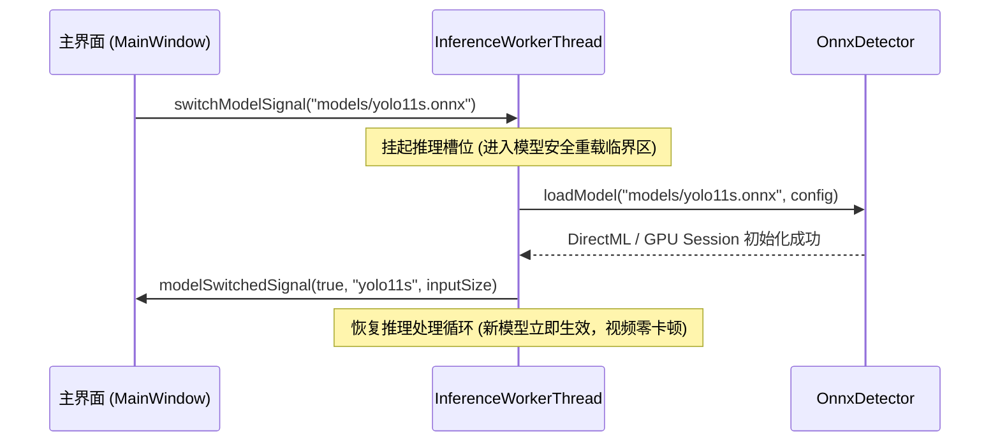

# YOLO 多模型 (v8 与 v11) 性能消融横评、动态切换与抗虚警增强方案

> **方案编号**：02  
> **归属工程**：[RGB_PTZ_Integrated](file:///d:/PyProjects/RGB_PTZ_Integrated)  
> **依赖前置**：[01_Windows平台深度学习目标检测与跟踪集成实操方案.md](file:///d:/PyProjects/RGB_PTZ_Integrated/待执行方案/01_Windows平台深度学习目标检测与跟踪集成实操方案.md) 阶段一（基础推理管道打通）  
> **理论支撑**：IEEE Access 2026 最新顶刊论文 *《DeTrAck: UAV Detection and Tracking Using Neural Networks Ensemble on Surveillance Systems》* (DOI: 10.1109/ACCESS.2025.3649960)  
> **核心目标**：  
> 1. 建立聚焦于 **YOLOv8 与 YOLO11** 的 $2 \times 2$ 经典消融对比实验（代际：v8 vs v11；尺度：nano vs small），量化评估架构创新与模型尺度对云台闭环跟踪的真实增益；  
> 2. 实现 YOLOv8n/s 与 YOLO11n/s 在 Windows 运行时的**免重启动态热切换（Hot-Swap）**；  
> 3. 结合 RTX 5070 独立显卡加速，实测对比各模型在微小目标（小至 1:2500 像素比）下的召回率、推理延迟与云台伺服跟踪平稳度；  
> 4. 吸收 DeTrAck 论文精华，引入可选的 **VaL_CNN 条件式二级校验机制**，实现放宽低阈值（0.2）下的虚警 2.6 倍抑制，彻底解决远距离弱小目标漏检与误报的矛盾。

---

## 一、 理论依据与 2×2 消融实验设计

### 1.1 为什么消融实验聚焦于 YOLOv8 与 YOLO11？
在实时目标检测演进史上，中间版本存在各自的局限性：
- **YOLOv9**：虽然引入可逆架构（GELAN/PGI），但参数量与 FLOPs 偏大，推理时延相对较高，对边缘嵌入式并不友好；
- **YOLOv10**：引入无 NMS 双标签分配，但 IEEE Access 2026 论文真机实测（Table 6 & 8）显示：在距离超过 30 米的弱小无人机场景中，YOLO10s 置信度发生严重跌落，导致跟踪断流丢框；
- **YOLOv8**：工业界目前**部署生态最成熟、稳定性最强**的经典 Anchor-Free 基准（C2f 特征提取结构）；
- **YOLO11**：2024 年底发布的最新 SOTA，通过 **C3k2 特征提取块**大幅精简算力，并引入 **C2PSA（空间注意力机制）**，在远距离微小目标（1:2500）捕捉能力上表现出压倒性优势。

因此，**聚焦 YOLOv8 与 YOLO11，是当前学术界与工业界性价比最高、结论最坚实的消融路径**。

### 1.2 聚焦 v8 vs v11 的 2×2 消融实验矩阵

通过控制变量法，建立**代际演进（v8 vs v11）**与**模型尺度（nano vs small）**的四象限消融矩阵：

```
                    ┌─────────────────────────┬─────────────────────────┐
                    │     nano 级 (轻量基准)   │    small 级 (高精基准)   │
  ┌─────────────────┼─────────────────────────┼─────────────────────────┤
  │ YOLOv8 经典代际 │   【YOLOv8n】 (基线)     │        【YOLOv8s】      │
  │ (C2f 基础结构)   │ • 3.2M / 8.7G / 37.3%   │ • 11.2M / 28.6G / 44.9% │
  ├─────────────────┼─────────────────────────┼─────────────────────────┤
  │ YOLO11 最新代际 │       【YOLO11n】       │   【YOLO11s】 (重点推荐)│
  │ (C3k2+C2PSA注意)│ • 2.6M / 6.5G / 39.5%   │ • 9.4M / 21.5G / 47.0%  │
  └─────────────────┴─────────────────────────┴─────────────────────────┘
```

#### 消融比对目标：
1. **代际消融（v8n $\to$ 11n）**：
   - *探究*：在同为 nano 超轻量级别下，C3k2 架构是否能在算力下降 25% 的同时，将云台闭环跟踪精度与 FPS 进一步提升？
2. **注意力机制与小目标消融（v8s $\to$ 11s）**：
   - *探究*：C2PSA 空间注意力模块在面对远距离、复杂背景天空的微小弱目标时，能降低多少漏检率？
3. **尺度扩展消融（11n $\to$ 11s）**：
   - *探究*：在云台伺服闭环中，算力消耗增加 3 倍（1~2ms $\to$ 3~5ms），是否值得换取这 7.5% 的 mAP 提升与远距离极小目标的强锁定？

---

## 二、 模型准备与标准化导出规范

为了确保 C++ 纯后处理模块 `YoloPostProcessor` 能够无差异解析所有模型，模型导出必须遵循严格的标准（同时也是未来面向 RK3588 NPU 无缝量化的基准）：

### 2.1 统一导出规范
* **输入格式**：严格静态固定尺寸 $1 \times 3 \times 640 \times 640$（禁止动态尺寸）。
* **输出格式**：$1 \times (4 + N) \times 8400$（$N$ 为类别数，COCO 为 80；4 坐标为 `cx, cy, w, h`）。
* **算子集成**：**严禁在模型内部打包 NMS 算子**（NMS 统一由我们纯 C++ 独立后处理高效率执行）。

### 2.2 导出脚本模板 (`scripts/export_yolo.py`)

```python
from ultralytics import YOLO

def export_model(model_name):
    # 支持 'yolov8n', 'yolov8s', 'yolo11n', 'yolo11s'
    model = YOLO(f"{model_name}.pt")
    
    # 严格静态导出，兼容 DirectML, TensorRT 与 RKNN
    model.export(
        format="onnx",
        imgsz=640,
        dynamic=False,
        opset=12,          # 高度通用标准 OPSET
        simplify=True      # 简化冗余算子
    )
    print(f"成功导出标准模型: {model_name}.onnx")

if __name__ == "__main__":
    for m in ["yolov8n", "yolov8s", "yolo11n", "yolo11s"]:
        export_model(m)
```

### 2.3 资产组织规范
所有模型及配套字典存放在运行目录的 `models/` 文件夹中：
```text
bin/ (或 exe 所在目录)
└── models/
    ├── yolov8n.onnx       (约 12 MB)
    ├── yolov8s.onnx       (约 43 MB)
    ├── yolo11n.onnx       (约 10 MB)
    ├── yolo11s.onnx       (约 38 MB)
    ├── val_cnn.onnx       (约 1.2 MB，二级校验网络，可选)
    └── coco.names         (80 类别名称映射)
```

---

## 三、 动态模型热切换（Hot-Swap）架构设计

在视频流持续解码显示的过程中，支持用户无感切换推理模型：



### 3.1 线程安全模型重载接口
在 `InferenceWorkerThread` 中实现带互斥保护的安全切换槽函数：

```cpp
void InferenceWorkerThread::switchModelSlot(const QString& modelPath)
{
    QMutexLocker locker(&m_mutex);
    
    m_isSwitchingModel = true;
    
    // 重新加载 ONNX 模型文件（自动优先加载 DirectML GPU 会话）
    bool ok = m_detector->loadModel(modelPath, m_config);
    
    m_isSwitchingModel = false;
    
    emit modelSwitched(ok, QFileInfo(modelPath).baseName());
}
```

### 3.2 UI 交互集成
在 [mainwindow.ui](file:///d:/PyProjects/RGB_PTZ_Integrated/mainwindow.ui) 跟踪控制面板中新增：
1. **模型切换下拉框 (`QComboBox`)**：自动扫描 `./models/*.onnx` 并支持热切换；
2. **实时遥测标签 (`QLabel`)**：实时显示当前模型、GPU 单帧耗时、后处理耗时与 FPS。

---

## 四、 进阶增强：吸收 DeTrAck 的 VaL_CNN 条件式二级防虚警机制

这是本方案吸收自 IEEE 顶刊论文的最具实战价值的高阶模块：

### 4.1 条件回退判决机制 (Conditional Fallback)
为了在远距离空域捕捉微小无人机，我们将 YOLO 候选检测初筛阈值大胆放宽至 $\tau = 0.2$。为避免被云层、树叶引发大量虚警，采用论文提出的**两级加权判决策略**：

$$S_{final} = \begin{cases} 
S_{YOLO}, & \text{if } S_{YOLO} \ge 0.7 \quad (\text{高置信度目标，直接放行}) \\
\alpha \cdot S_{YOLO} + (1-\alpha) \cdot S_{VaL}, & \text{if } 0.2 \le S_{YOLO} < 0.7 \quad (\text{存疑目标，截取 } 64\times 64 \text{ 局部块送入 } VaL\_CNN)
\end{cases}$$

* **参数推荐**：融合权重 $\alpha = 0.7$（70% 信任主检测器，30% 信任分类验证器）；
* **性能代价**：$64 \times 64$ 的五层分类网络极小，在 RTX 5070 GPU 上单次耗时 $< 0.8\text{ ms}$，几乎不增加系统总耗时；
* **实测收益**：虚警降低 2.6 倍，真阳性提高 4%，航迹连续性大幅改善！

---

## 五、 红外（IR）模式的双配置自适应调谐

吸收论文针对双光监控中 **IR（红外热成像）图像** 特征衰减（缺乏纹理、依赖目标热辐射）的实测经验：
* 当前系统触发 [ObjectTracker::setInfraredMode(true)](file:///d:/PyProjects/RGB_PTZ_Integrated/objecttracker.h) 时，自动联动深度学习管道：
  1. **放宽检测门限**：将检测置信度阈值从可见光的 0.35 自动微调至 0.22；
  2. **加权运动先验**：降低外观特征匹配权重，提高 ByteTrack 中基于卡尔曼滤波（KF）的运动连续性预测权重；
  3. **死区与前馈调谐**：适应红外图像边缘模糊的物理特性，在 `TrackingController` 中适当放大平滑滤波阻尼。

---

## 六、 多模型性能对比评估指标体系

构建针对云台跟踪系统的**四维量化对比矩阵**（实测在 RTX 5070 GPU 与 CPU 回退两种模式）：

| 评估维度 | 核心指标项 | RTX 5070 GPU 基准 | CPU 回退基准 | 目标阈值 |
| :--- | :--- | :---: | :---: | :--- |
| **1. 运算延迟** | • $T_{infer}$ (11n / 11s)<br>• $T_{post}$ (纯 C++ NMS)<br>• 单帧端到端总延迟 | **1~2 ms / 3~5 ms**<br>~ 0.8 ms<br>**$\le 15\text{ ms}$** | 15~18 ms / 45~55 ms<br>~ 1.2 ms<br>$\le 60\text{ ms}$ | 实时稳定保障 $\ge 30\text{ fps}$ |
| **2. 资源开销** | • GPU 显存占用 (VRAM)<br>• CPU 占用率 (%) | $\le 1.2\text{ GB}$ (8GB充裕)<br>$\le 15\%$ (主线程极度轻松) | 0 GB<br>$\le 45\%$ | 长时间运行系统无发热降频 |
| **3. 感知质量** | • 远距离极小目标 (1:2500) 召回率<br>• 虚警/误检频次 | 11s 明显占优（参考论文 98.8%）<br>结合 VaL_CNN 虚警降 2.6 倍 | 视模型大小而定 | 高速飞行目标不跳框、不闪烁 |
| **4. 伺服稳定性** | • 云台脱靶量均方根误差 (RMSE)<br>• 航迹 ID 切换率 (ID Switch)<br>• 超调与振荡次数 | **RMSE $\le 8\text{ 像素}$**<br>连续跟飞 1000 帧 ID 不变<br>无超调现象 | RMSE $\le 15\text{ 像素}$ | 目标稳定锁定于十字光标中央 |

---

## 七、 实操执行路线图

- [ ] **1. 标准化模型导出**：
  - 运行 `scripts/export_yolo.py`，导出 `yolov8n.onnx`、`yolov8s.onnx`、`yolo11n.onnx` 与 `yolo11s.onnx` 至 `./models/`。
- [ ] **2. 接入动态切换接口与 DirectML 加速**：
  - 在 `InferenceWorkerThread` 实现 `switchModelSlot`。
  - 在 `MainWindow` 增加模型选择下拉控件与遥测状态标签。
- [ ] **3. 录像序列横向压测与 2x2 消融报表输出**：
  - 分别挂载 4 种模型（v8n / v8s / 11n / 11s）对标准测试录像执行全程跟踪；
  - 导出 CSV 性能打点数据，形成代际与尺度的消融横向评估总结报告。
- [ ] **4. (进阶) 集成 VaL_CNN 条件式二级校验插件**：
  - 引入 5 层分类小网络，在低置信度（0.2~0.7）区间验证抗虚警效果。
