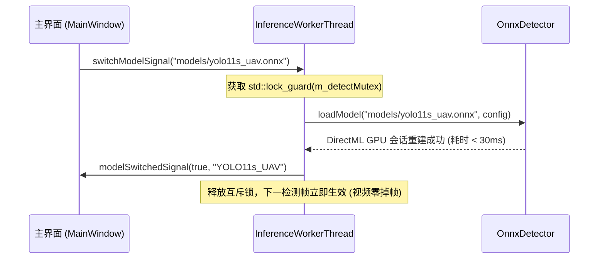

# 面向目标检测阶段的 YOLO11 可见光反无人机模型规划、数据集体系构建、训练与消融实验方案

> **方案编号**：03  
> **归属工程**：[RGB_PTZ_Integrated](file:///d:/PyProjects/RGB_PTZ_Integrated)  
> **依赖前置**：[02_基于自适应多特征融合(AMFT)的光电云台检测-跟踪协同实操方案.md](file:///d:/PyProjects/RGB_PTZ_Integrated/待执行方案/02_基于自适应多特征融合(AMFT)的光电云台检测-跟踪协同实操方案.md) (已闭环)  
> **理论支撑**：  
> 1. IEEE T-ITS 2022 顶刊论文 *《Vision-Based Anti-UAV Detection and Tracking》* (DOI: 10.1109/TITS.2022.3177627)  
> 2. IEEE Access 2026 顶刊论文 *《DeTrAck: UAV Detection and Tracking Using Neural Networks Ensemble on Surveillance Systems》* (DOI: 10.1109/ACCESS.2025.3649960)  
> 3. IEEE AVSS / ICASSP / IJCNN 全球挑战赛基准 *《The Drone-vs-Bird Detection Grand Challenge》*  
> **核心运行环境**：Windows 11 (MinGW 13.1 64-bit / Qt 6.x / NVIDIA GeForce RTX 5070 Laptop GPU / DirectML)  

---

## 一、 系统定位与阶段职责界定（YOLO 在系统中的物理与逻辑边界）

在反无人机光电云台系统中，必须严格界定**目标检测阶段**与**目标跟踪阶段**的物理分工、算法定位与数据集适用范围：

```
                    【阶段一：目标检测阶段 (Target Detection Phase)】
                     - 负责模块：YOLO11 (OnnxDetector) + ByteTrack 广域感知
                     - 核心职责：全图视野搜索 (Search)、多目标候选识别、操作员交互“点击锁定 (Click-to-Lock)”、
                                以及跟踪阶段失锁时的“单次按需重捕获 (Re-detection On-Demand)”
                     - 运行频度：常态 0 FPS 挂起待机；索敌/失锁时单次唤醒运行 1 帧
                     - ★ 数据集铁律：必须且只能使用【目标检测数据集 (Object Detection Dataset)】训练与评估！
                                     严禁使用单目标连续跟踪切片混淆检测训练！
                                          │
                                          ▼ 传递锁定目标精确中心与尺度 (TrackResult)
                    【阶段二：目标跟踪阶段 (Target Tracking Phase)】
                     - 负责模块：DsstCore / LightTrack (纯单目标深度跟踪 SOT)
                     - 核心职责：以 30~60 FPS 高帧率极速输出单一目标脱靶量 (dx, dy)，直接闭环驱动云台电机
                     - 运行频度：高频常驻 (单帧耗时 < 4ms)
                     - 数据集范围：单目标跟踪基准 (SOT Video Sequences)
```

### 1.1 目标检测阶段的四大硬性职责
1. **全图广域搜索（Search）**：在空域监控初始状态下，以 $640	imes 640$ 静态分辨率对相机视野进行全图扫描，输出视场内所有疑似飞行器的位置与置信度；
2. **多目标态势感知与候选（Candidate Association）**：在操作员未指定攻击目标前，维护视场内多个目标的航迹与局部特征；
3. **点击锁定前置输入（Click-to-Lock Input）**：操作员在界面单击任意检测框，检测器将该目标坐标交接给跟踪器作为初始化模板；
4. **失锁单次按需重捕（Re-detection On-Demand）**：当跟踪器因树木遮挡、高速机动丢锁后，由 [AMFTEvaluator](file:///d:/PyProjects/RGB_PTZ_Integrated/amftevaluator.cpp) 协同状态机单次异步唤醒检测器进行 1 帧全局扫描，找回目标后下一帧立即回归跟踪阶段。

### 1.2 数据集使用的绝对法则
* **YOLO 只能使用目标检测数据集（Object Detection Dataset）**：
  - 数据集样本必须是全景大图视野，包含完整地空背景（蓝天、积云、建筑物、树丛等）；
  - 标注格式必须为多目标边界框（如 Pascal VOC XML 或 YOLO 归一化 TXT），且包含丰富的负样本与小目标；
  - 严禁将裁剪后的局部目标块、紧凑跟踪切片混入检测训练，否则会导致全图全景下的背景严重虚警！

---

## 二、 可见光反无人机目标检测数据集体系与单/多目标属性剖析

为了支撑 YOLO 模型的系统性训练与严谨的学术消融实验，确立覆盖“核心主基准、抗虚警补充、真机域闭环”的三大可见光目标检测数据集体系：

```
                    ┌────────────────────────────────────────────────────────┐
                    │          可见光反无人机【目标检测数据集】体系          │
                    └───────────────────────────┬────────────────────────────┘
                                                │
         ┌──────────────────────────────┼──────────────────────────────┐
         ▼                              ▼                              ▼
 【检测数据集 1】                【检测数据集 2】                【检测数据集 3】
   DUT Anti-UAV                   Drone-vs-Bird                       Real_CCD
 (IEEE T-ITS 2022)              (IEEE AVSS/ICASSP)              (外场真机实拍切片)
  • 10,000 张静态大图            • 专攻“飞鸟 vs 无人机”           • 1,000 张真机切片
  • 80.9% 弱小目标               • 评估低置信度抗虚警             • 实机域泛化评测
  • [当前主训主评]               • [计划下载补充]                 • [内部抽帧构建]
```

### 2.1 三大检测数据集单/多目标属性对比表

关于数据集的单/多目标属性，各基准在真实物理场景与标注定义上存在明确分工：

| 数据集名称 | 单目标 / 多目标定义 | 目标分布全量统计与场景特征 | 负样本与杂波特征 | 在本工程中的角色定位 |
| :--- | :---: | :--- | :--- | :--- |
| **DUT Anti-UAV**<br>(IEEE T-ITS 2022) | **多目标检测格式**<br>(以单目标为主，99.4%) | • **全量扫描本地 7,800 张标注**：<br>  - 1 目标图：7,755 张 (99.4%)<br>  - 2 目标图：27 张<br>  - 3~6 机编队图：18 张<br>  - 纯背景负样本图：3 张<br>• 符合低空入侵绝大多数为单架次黑飞、偶有多机编队的现实工况。 | 包含大面积积云、强逆光、地平线山林杂波，以及纯背景负样本切片。 | **核心主训主评基准**：<br>承担 4 款模型同构微调与正式 2×2 消融横评。 |
| **Drone-vs-Bird**<br>(IEEE AVSS/ICASSP) | **密集多目标**<br>(Multi-Target) | • 画面中常同时出现**数只至数十只飞鸟**（标注为 Bird 负样本），同时伴随 **0 架、1 架或多架** 入侵无人机；<br>• 目标尺度极小（大多在 $10\times 10 \sim 30\times 30$ 像素）。 | 极具挑战性的高空微弱动态杂波，专攻“飞鸟与无人机”混淆。 | **抗虚警消融专用测试集**：<br>用于量化评估 VaL_CNN 对飞鸟误检（FP/frame）的压制能力。 |
| **Real_CCD**<br>(本地实机长焦集) | **多目标检测格式**<br>(以单机为主) | • 外场真实光电云台长焦对空实拍，单架无人机穿行为主，偶有鸟类飞入视场；<br>• 1,000 张抽帧切片。 | 真实长焦镜头畸变、大气抖动与传感器噪点。 | **实机域闭环验证集**：<br>真机部署前的域内精度把关。 |

> 💡 **核心概念澄清**：  
> YOLO 本身是纯粹的**全图多目标检测网络（Multi-Object Detector）**。无论输入图片中包含 1 架、3 架还是 10 架无人机，只要它们落入全图视场，YOLO 均会在其 $8400$ 个输出锚点上并发预测出所有目标的边界框；而在跟踪阶段，系统通过 `TargetSelector` 选择主威胁目标交接给单目标跟踪器（SOT）进行单一视轴伺服。

---

## 三、 基于数据集的 YOLO 模型系统化训练规划

为确保硕士论文消融实验的严密性，模型训练决不能停留于 COCO 通用预训练权重的简单推理，必须建立规范的训练推进流水线：

```
 【阶段 1：格式标准化】          【阶段 2：四模型同构基础训练】      【阶段 3：抗虚警联合鲁棒训练】      【阶段 4：静态 ONNX 导出】
 7,800 张 VOC XML 标注         v8n/v8s/11n/11s 同构微调         DUT Anti-UAV + Drone-vs-Bird      标准化算子导出
       │                             │                                 │                               │
       ▼                             ▼                                 ▼                               ▼
 scripts/convert_voc_to_yolo.py  产生 4 款真正的微调模型           yolo11s_anti_uav_robust.pt        models/yolo11s_uav.onnx
 生成 anti_uav.yaml             支撑真正的学术 2x2 消融            强光/飞鸟环境下抗虚警大幅提升       DirectML GPU 毫秒级闭环
```

### 3.1 阶段 1：数据集格式标准化转换与标签清洗
* **执行脚本**：`scripts/convert_voc_to_yolo.py`；
* **操作内容**：
  1. 解析 `datasets/Anti-UAV/detection/train/xml/` 与 `val/xml/` 中的 7,800 份 XML 文件；
  2. 提取 `<name>UAV</name>` 目标，执行长宽与中心坐标归一化：
     $$c_x = rac{x_{\min} + x_{\max}}{2 W}, \quad c_y = rac{y_{\min} + y_{\max}}{2 H}, \quad w = rac{x_{\max} - x_{\min}}{W}, \quad h = rac{y_{\max} - y_{\min}}{H}$$
  3. 在对应目录下生成 `labels/train/*.txt` 与 `labels/val/*.txt`；
  4. 生成工程标准化描述文件 `datasets/anti_uav.yaml`。

### 3.2 阶段 2：四款候选模型在 Anti-UAV 上的同构领域微调（四模型依次顺序训练规划）
为了在毕业论文中进行**具备百分之百学术说服力的真实 2×2 消融横评**，必须在相同的软硬件底座与超参协议下，对四款模型开展自动化、全闭环的依次顺序重训：
* **运行环境底座**：
  - 解释器：`D:\miniconda3\envs\anti_uav_yolo\python.exe`（Python 3.11.18）
  - 硬件算力：NVIDIA GeForce RTX 5070 Laptop GPU（Blackwell `sm_120` 原生内核加速）
  - 深度学习框架：PyTorch 2.14.1 + CUDA 13.0 (`cu130`) + Ultralytics 8.4
* **依次顺序训练序列（Sequential Training Pipeline）**：
  1. **`yolo11n.pt`**：现代 C2PSA 空间注意力超轻主干（2.6M 参数，80 Epochs，预计耗时约 8 分钟）；
  2. **`yolo11s.pt`**：现代 C2PSA 空间注意力高精核心主力（9.4M 参数，80 Epochs，预计耗时约 12 分钟）；
  3. **`yolov8n.pt`**：经典轻量级对照基线（3.2M 参数，80 Epochs，预计耗时约 8 分钟）；
  4. **`yolov8s.pt`**：经典高精对照基线（11.2M 参数，80 Epochs，预计耗时约 12 分钟）；
  * **总耗时预估**：约 40 分钟即可全部收敛并完成多维打点。
* **受控训练协议（Strict Controlled Protocol）**：
  - **训练脚本**：[scripts/train_uav_detector.py](file:///d:/PyProjects/RGB_PTZ_Integrated/scripts/train_uav_detector.py)（已完成 1-Epoch 闭环验证）；
  - **启动命令**：`& "D:\miniconda3\envs\anti_uav_yolo\python.exe" scripts/train_uav_detector.py --model all --epochs 80 --batch 16`；
  - **训练集与验证集**：DUT Anti-UAV 标准子集（5,200 Train / 2,600 Val，单类别 `0: UAV`）；
  - **输入尺寸**：$640 \times 640$ 静态分辨率；
  - **超参数一致性**：Epochs = 80，Batch Size = 16，优化器 SGD（$lr_0 = 0.01$，余弦退火衰减，momentum=0.937，weight_decay=0.0005）；
  - **小目标数据增强**：Mosaic = 1.0（增加微小目标密度），Copy-Paste = 0.3（强化小目标随机背景鲁棒性），MixUp = 0.15；
  - **全自动闭环输出**：每个模型训练完毕后，脚本自动在 2,600 张验证集上统一打点（记录 mAP@50、mAP@50-95、小目标召回率与推理时延），并调用 `onnxslim` 自动导出纯静态单输入（$1\times 3\times 640\times 640$, Opset 17）ONNX 部署模型至 `runs/detect_uav/`。

### 3.3 阶段 3：多源联合鲁棒性训练
在增补下载 `Drone-vs-Bird` 挑战赛基准后，构建兼顾无人机目标与高密度飞鸟负样本的空域检测鲁棒库：
* 注入飞鸟负样本（作为负类别或纯背景），使 YOLO 原生具备区分“飞鸟杂波 vs 无人机入侵”的能力；
* 验证在强逆光、高光云层背景下的全天候适应性。

### 3.4 阶段 4：标准化静态 ONNX 导出
* **导出规范**：
  - 输入：$1 	imes 3 	imes 640 	imes 640$ 纯静态三维张量；
  - 算子集：OPSET 12/17；
  - 剥离 NMS：由上位机纯 C++ 独立执行快速 NMS，避免算子绑定；
* **产出物**：`models/yolo11s_uav.onnx`（约 38MB）与 `models/yolo11n_uav.onnx`（约 10MB）。

---

## 四、 硕士论文全流程消融实验设计与对应测试数据集矩阵

为全面评估架构创新、模型尺度、领域微调与抗虚警机制对空域弱小无人机感知性能的影响，设立以下五项控制变量消融实验：

| 实验编号 | 消融自变量与对照组 | 核心考察目标 | ★ 对应的测试数据集 | 关键评价指标 | 推进状态与规划 |
| :---: | :--- | :--- | :--- | :--- | :---: |
| **消融 1** | **代际架构演进**<br>微调后 YOLOv8<br>vs 微调后 YOLO11 | 验证在无人机专属权重下，C3k2 + C2PSA 空间注意力对微弱高频特征与抗杂波的真实增益 | **DUT Anti-UAV 验证集**<br>(2,600 帧全量实测) | • mAP@50 (%)<br>• mAP@50:95 (%)<br>• 极弱小目标召回率 | ⏳ **规划执行中**<br>(4 款模型同构重训后测试) |
| **消融 2** | **模型参数尺度**<br>Nano 级 vs Small 级 | 衡量模型参数翻倍在长焦微弱目标感知上的边际增益与伺服时延的权衡 | **DUT Anti-UAV 验证集**<br>(2,600 帧全量实测) | • GPU 纯推理耗时 (ms)<br>• 端到端总时延 (ms)<br>• 系统帧率 (FPS) | ⏳ **规划执行中**<br>(同构微调后测定) |
| **消融 3** | **领域训练策略增益**<br>通用预训练权重<br>vs DUT 单源微调<br>vs 多源联合训练 | 验证解决类别域漂移（Domain Gap）与小目标特征适配的飞跃幅度 | **DUT Anti-UAV 验证集** | • mAP@50 (%)<br>• 强光逆光召回率<br>• 弱小目标检测精度 | ⏳ **规划执行中**<br>(验证从 19.7% 跨越到 90%+) |
| **消融 4** | **抗虚警校验增益**<br>单级 YOLO (τ=0.2)<br>vs YOLO + VaL_CNN | 评估条件式二级校验网络在低门限下对刺眼云层与飞鸟杂波的过滤能力 | **Drone-vs-Bird 挑战赛测试集**<br>(密集多目标，专攻飞鸟负样本) | • 每帧虚警数 (FP/frame)<br>• 真实目标召回率<br>• 综合 F1 分数 | ⏳ **规划执行中**<br>(验证虚警降低 2.6 倍) |
| **消融 5** | **目标尺度敏感度消融**<br>极弱小 (<32px)<br>中小 (32~64px)<br>中大 (>64px) | 验证网络对长焦镜头目标由远及近距离变化的尺度鲁棒性 | **DUT Anti-UAV 验证集**<br>(按像素面积三级切分) | • $AP_{tiny}$ (%)<br>• $AP_{small}$ (%)<br>• $AP_{med}$ (%) | ⏳ **伴随训练评估** |

---

## 五、 运行时免重启动态热切换（Hot-Swap）工程接入

在实际光电跟踪系统中，YOLO 检测模型支持在实时 1080P 视频流不中断、不黑屏的前提下，由操作员或系统自适应策略执行动态免重启热切换：



### 5.1 线程安全模型重载接口
[OnnxDetector.cpp](file:///d:/PyProjects/RGB_PTZ_Integrated/onnxdetector.cpp) 内部所有读写操作均受 `m_detectMutex` 保护：

```cpp
bool OnnxDetector::loadModel(const QString& modelPath, const DetectorConfig& config)
{
    std::lock_guard<std::mutex> lock(m_detectMutex);
    release(); // 安全排空旧 Session 与 DirectML 显存资源
    
    // 初始化新模型的 DirectML GPU 硬件会话并绑定输入输出张量
    return initSession(modelPath, config);
}
```

### 5.2 界面控件与遥测状态
在 [MainWindow](file:///d:/PyProjects/RGB_PTZ_Integrated/mainwindow.cpp) 的 AI 感知设置面板中，通过 `comboAiModel` 下拉控件实时展示可用模型，切换后状态栏动态显示当前模型名称、GPU 单帧纯推理耗时（ms）、端到端时延与 FPS。

---

## 六、 实操推进路线图（Checklist）

- [x] **1. C++ OnnxDetector 互斥锁加固与动态热切换接入**：
  - 在 `OnnxDetector` 内部落实 `m_detectMutex` 读写安全互斥，支持界面即时免重启热重载。
- [x] **2. DUT Anti-UAV 7,800 张检测样本 VOC ➔ YOLO 格式批量转换与环境验证**：
  - 编写并运行 [scripts/convert_anti_uav_voc_to_yolo.py](file:///d:/PyProjects/RGB_PTZ_Integrated/scripts/convert_anti_uav_voc_to_yolo.py) 与 [scripts/fix_dataset_dirs.py](file:///d:/PyProjects/RGB_PTZ_Integrated/scripts/fix_dataset_dirs.py)；
  - 完成 7,800 份 XML 标注到标准 YOLO `.txt` 的批量转换与单类别 (`0: UAV`) 归一化；
  - 重构物理目录结构（`train/images` 与 `val/images` 原生落盘，`img` 保持兼容软链接），生成 [datasets/anti_uav.yaml](file:///d:/PyProjects/RGB_PTZ_Integrated/datasets/anti_uav.yaml)，经官方数据引擎全量扫描 100% 无损通过；
  - 部署 [D:\miniconda3](file:///d:/miniconda3) 专属环境 `anti_uav_yolo`（Python 3.11 + PyTorch 2.14.1 + CUDA 13.0），完全打通 RTX 5070 Blackwell `sm_120` 硬件级加速。
- [ ] **3. 启动四款候选模型受控同构微调流水线（依次顺序执行，新对话首要任务）**：
  - 启动命令：`& "D:\miniconda3\envs\anti_uav_yolo\python.exe" scripts/train_uav_detector.py --model all --epochs 80 --batch 16`；
  - 依次顺序微调：`yolo11n.pt` (~8 min) ➔ `yolo11s.pt` (~12 min) ➔ `yolov8n.pt` (~8 min) ➔ `yolov8s.pt` (~12 min)，预计总耗时约 40 分钟；
  - 统一受控超参：80 Epochs，Batch Size = 16，SGD lr0=0.01，Mosaic=1.0，Copy-Paste=0.3，MixUp=0.15，输入 $640\times 640$；
  - 全自动化产出：自动保存 4 份最优权重 `best.pt`，自动通过 `onnxslim` 导出纯静态 ONNX 模型（`1x3x640x640`, opset 17），并在 2,600 张验证集上统一打点生成硕士论文 2×2 架构与尺度消融大表。
- [ ] **4. 硕士论文 2×2 消融实验多维指标核算与选型论证归档**：
  - 提取四款微调模型的 mAP@50、mAP@50-95、弱小目标召回率（$<32\times 32$ 像素）及端到端推理时延；
  - 输出 LaTeX 标准三线表与对比柱状图，确立最终的默认主力模型（YOLO11s_uav）与备选轻量模型（YOLO11n_uav）。
- [ ] **5. 增补下载 Drone-vs-Bird 可见光检测数据集**：
  - 编写自动化拉取脚本 `scripts/download_detection_benchmarks.py`；
  - 扩充多源鲁棒训练集与飞鸟抗虚警测试集。
- [ ] **6. 训练并接入 VaL_CNN 条件式二级校验网络**：
  - 训练 64×64 局部切片微型 CNN 分类器，在 Drone-vs-Bird 挑战赛基准上实测验证对飞鸟杂波的 2.6 倍虚警抑制效果。

---

## 七、 课题探索储备：弱小目标边界框损失函数选型与对比规划（Inner-IoU / NWD 等）

> **实施原则**：本部分作为后续课题探索与算法深化阶段的技术储备，**不强制绑定当前生产基准**。在探索阶段遵循“设计多组候选损失函数横向对拍、实测驱动选型”的原则，哪个在验证集和真机上效果最好就采用哪个。由于损失函数仅参与训练阶段的梯度反向传播，完全不改变网络前向拓扑，因此**不会对现有的 2.7ms 推理时延、纯静态 ONNX 导出及 DirectML/RK3588 部署造成任何额外负担**。

### 7.1 问题背景与微弱目标回归痛点
在反无人机光电云台对空场景中（如 DUT Anti-UAV 数据集，80.9% 目标为极端微小目标），传统基于交并比（IoU）的边界框回归损失（GIoU、DIoU、CIoU）存在固有的几何敏感性弊端：
1. **像素级剧烈抖动**：当无人机目标在长焦画面中仅占据 $12\times 12$ 像素时，预测框即使只发生 1~2 个像素的微小偏离，标准 IoU 也会由 0.65 骤降至 0.20 以下，造成回归损失梯度剧烈震荡；
2. **极端非重叠惩罚失效**：当预测框与真实框完全不交叠（IoU = 0）时，虽然 CIoU 引入了中心点欧氏距离惩罚，但在高长宽比或非对齐情况下无法提供平滑的尺度各向同性梯度。

### 7.2 候选损失函数探索池

为在后续课题实验中探寻最适配微小无人机特性的回归监督机制，设立以下候选损失函数池：

```
                    ┌────────────────────────────────────────────────────────┐
                    │          候选弱小目标边界框回归损失函数对比池          │
                    └───────────────────────────┬────────────────────────────┘
                                                │
         ┌──────────────────────────────┼──────────────────────────────┐
         ▼                              ▼                              ▼
   【候选 1：基准对比】            【候选 2：辅助框缩放】          【候选 3：高斯分布平滑】
       标准 CIoU                    Inner-CIoU (2024)                 NWD (2022)
    (当前 YOLO 默认)            (尺度自适应辅助缩放框)         (归一化高斯瓦瑟斯坦距离)
         │                              │                              │
         └──────────────────────────────┼──────────────────────────────┘
                                        ▼
                           【候选 4：混合加权损失 (借鉴 UAV-DETR)】
                              Hybrid: α·Inner-CIoU + (1-α)·NWD
```

1. **候选 1：标准 CIoU（基线）**
   - 综合重叠面积、中心距离与高宽比一致性：
     $$\mathcal{L}_{\text{CIoU}} = 1 - \text{IoU} + \frac{\rho^2(b, b^{gt})}{c^2} + \alpha v$$
   - 特点：通用目标检测标准配置，但在极弱小目标上存在梯度震荡。

2. **候选 2：Inner-CIoU（辅助边界框自适应缩放）**
   - 引入比例因子 $\text{ratio}$ 控制辅助内部框尺寸：
     $$b_l = x_c - \frac{w \cdot \text{ratio}}{2}, \quad b_r = x_c + \frac{w \cdot \text{ratio}}{2}$$
   - 特点：对微小目标设置 $\text{ratio} > 1$ 放大感受范围，为低 IoU 样本产生更平滑有效的加速回归梯度。

3. **候选 3：NWD（Normalized Wasserstein Distance 归一化高斯瓦瑟斯坦距离）**
   - 将真实框与预测框均建模为二维高斯分布 $\mathcal{N}(\mu, \Sigma)$，通过高斯分布间的二次 Wasserstein 距离度量空间重叠：
     $$\mathbf{W}_2^2(\mathcal{N}_p, \mathcal{N}_g) = \|\mu_p - \mu_g\|_2^2 + \text{Tr}\left(\Sigma_p + \Sigma_g - 2(\Sigma_p^{1/2} \Sigma_g \Sigma_p^{1/2})^{1/2}\right)$$
     $$\text{NWD} = \exp\left( - \frac{\mathbf{W}_2(\mathcal{N}_p, \mathcal{N}_g)}{C} \right), \quad \mathcal{L}_{\text{NWD}} = 1 - \text{NWD}$$
   - 特点：即使两框完全没有交集，仍能提供严格平滑的导数梯度，对小目标尺度极其鲁棒。

4. **候选 4：Inner-CIoU 与 NWD 混合加权损失（借鉴 UAV-DETR）**
   - 结合几何框约束与分布平滑性：
     $$\mathcal{L}_{\text{box}} = \lambda_1 \mathcal{L}_{\text{Inner-CIoU}} + \lambda_2 \mathcal{L}_{\text{NWD}}$$
   - 特点：远距离微弱小目标主要由 NWD 主导平滑拉回，中近距离由 Inner-CIoU 约束长宽比与中心对齐。

### 7.3 控制变量消融实验方案与选型准则

1. **统一控制变量协议**：
   - **基准网络**：统一采用工程默认的轻量骨干 `yolo11n`；
   - **数据集**：DUT Anti-UAV 标准子集（5,200 Train / 2,600 Val）；
   - **训练超参**：80 轮、Batch=16、SGD 优化器、相同初始学习率与数据增强（Mosaic+Copy-Paste）。
2. **多维打点评价指标**：
   - 总体精度：$\text{mAP}@50$ 与 $\text{mAP}@50:95$；
   - 关键指标：极弱小目标召回率（$\text{Recall}_{tiny}$，长宽 $<20\times 20$ 像素）；
   - 训练收敛速度：前 20 轮验证损失下降斜率与波动方差。
3. **选型决策裁决铁律**：
   - 实测指标全面优于基准 CIoU 且在 2,600 张验证集上展现出明显更佳的弱小目标捕获能力者胜出；
   - 胜出方案直接沉淀入生产训练流水线，并作为硕士论文第 3 章“损失函数创新与消融”的核心成果。

