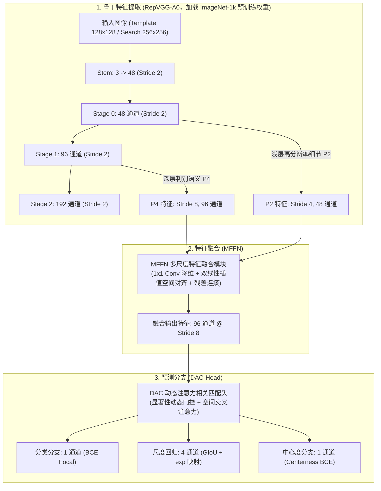
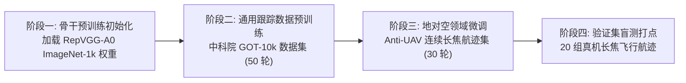

# 方案 04B：基于预训练骨干初始化与尺度回归修复的 SOT 重训实操方案

> **方案编号**：04B（单目标跟踪核心算法深化与重训方案）  
> **归属工程**：[RGB_PTZ_Integrated](file:///d:/PyProjects/RGB_PTZ_Integrated)  
> **前置依赖**：[SOT_Tracking_Baselines 真实基准数据](file:///D:/PyProjects/SOT_Tracking_Baselines/results/tables/thesis_three_line_table.md)、[待执行方案/SOT重训数据集下载与准备指南.md](file:///d:/PyProjects/RGB_PTZ_Integrated/待执行方案/SOT重训数据集下载与准备指南.md)  
> **计算平台**：RTX 4080 Super 台式机（16GB GDDR6X 显存，10,240 CUDA 核心）  
> **当前状态**：🟡 **方案就绪（数据准备中，待数据下载解压后启动代码适配与训练）**  

---

## 一、 方案背景与目标

### 1.1 现状指标与问题定位
在 20 组真机长焦航迹（24,804 帧）评测中，自研轻量网络 LightUAV-SOT 实测指标如下：
* **距离精度 (DP@20)**：75.32%；
* **推理时延与帧率**：纯模型推理 4.45 ms（224.5 FPS）；
* **综合成功率 (Success AUC)**：22.99%；
* **平均中心误差 (Mean CLE)**：167.2 px。

核心问题表现为：中心点预测相对集中，但边界框尺度回归存在发散与漂移，导致 IoU 偏低。

### 1.2 改进目标
在保持轻量化与推理时延（$\le 3.5\text{ ms}$）的前提下，通过骨干预训练权重初始化、通用跟踪数据预训练、地对空航迹领域微调以及尺度回归损失函数优化，提升边界框回归质量与综合成功率。

---

## 二、 网络架构设计与参数配置

系统由骨干网络（RepVGG-A0）、多尺度特征融合模块（MFFN）与动态注意力匹配头（DAC-Head）构成：

### 2.1 模块规格与接口参数
1. **骨干特征提取**：
   - 基础结构：RepVGG-A0（训练期多分支，推断期一键折叠为单路 $3\times 3$ 卷积）；
   - 浅层细节特征 $P_2$：抽取自 Stage 0 输出，步长 4，通道数 48；
   - 深层语义特征 $P_4$：抽取自 Stage 1 输出，步长 8，通道数 96；
   - 搜索区域特征图尺寸：$32\times 32$（相比步长 16 的 $16\times 16$ 网格，正样本监督点增加 4 倍）。
2. **MFFN 融合接口**：
   - `in_channels_shallow`: 48
   - `in_channels_deep`: 96
   - `fusion_dim`: 96
3. **DAC-Head 输出预测三分支**：
   - 分类头（Cls）：1 通道，输出前景概率；
   - 尺度回归头（Reg）：4 通道，预测边界偏移量 $(l, t, r, b)$；
   - 质量评估头（Centerness）：1 通道，预测网格点相对目标几何中心的偏心度。

---

## 三、 尺度回归与损失函数设计

### 3.1 坐标指数映射
坐标回归采用指数映射，避免零点截断与小目标梯度消失：
$$\text{offset} = \exp(\text{pred}) \times \text{stride}$$
在网格点 $(x_c, y_c)$ 处，预测框绝对坐标计算为：
$$x_1 = x_c - l, \quad y_1 = y_c - t, \quad x_2 = x_c + r, \quad y_2 = y_c + b$$

### 3.2 损失函数组合
总损失由分类损失、广义交并比损失（GIoU）与中心度损失（Centerness）加权构成：
$$\mathcal{L}_{\text{total}} = \mathcal{L}_{\text{cls}} + \lambda_{\text{giou}} \mathcal{L}_{\text{GIoU}} + \lambda_{\text{cen}} \mathcal{L}_{\text{cen}}$$
* $\mathcal{L}_{\text{cls}}$：Focal Loss（$\alpha=0.75, \gamma=2.0$）；
* $\mathcal{L}_{\text{GIoU}}$：预测框与真实框的 GIoU 损失（权重系数 $\lambda_{\text{giou}} = 2.0$）；
* $\mathcal{L}_{\text{cen}}$：中心度真实值采用几何均值生成：
  $$\text{Centerness}^* = \sqrt{\frac{\min(l, r)}{\max(l, r)} \times \frac{\min(t, b)}{\max(t, b)}}$$
  偏心度损失采用二值交叉熵（权重系数 $\lambda_{\text{cen}} = 1.0$）。

### 3.3 推理联合排序
单帧目标定位得分采用联合乘积排序：
$$\text{Score}(x, y) = \sqrt{\text{Cls}(x, y) \times \text{Centerness}(x, y)}$$

---

## 四、 训练流程与数据组织

训练分为骨干预训练初始化、通用跟踪数据预训练与地对空领域微调三个阶段：

### 4.1 阶段一：骨干预训练权重初始化
* 权重文件：RepVGG-A0 官方 ImageNet-1k 预训练模型（本地已缓存，文件大小 36.5 MB）；
* 操作：初始化骨干各层卷积参数，分类全连接层不参与跟踪任务。

### 4.2 阶段二：通用单目标跟踪预训练
* **数据集**：中科院 GOT-10k（9,335 段视频，140 万标注帧）；
* **训练配置**：
  - 硬件平台：RTX 4080 Super（16GB）；
  - 批大小 (Batch Size)：64；
  - 混合精度：AMP FP16；
  - 训练轮数：50 轮；
  - 单轮采样：60,000 对时序切片；
  - 优化器：AdamW（权重衰减 $1\times 10^{-4}$）；
  - 学习率策略：前 10 轮冻结骨干（仅训练 MFFN 与 DAC-Head，lr = $1\times 10^{-3}$）；后 40 轮解冻骨干（骨干 lr = $1\times 10^{-4}$，全局 lr = $1\times 10^{-3}$ 余弦退火衰减至 $1\times 10^{-6}$）；
  - 预估挂机耗时：约 15 ~ 24 小时。

### 4.3 阶段三：地对空反无人机领域微调
* **数据集**：Anti-UAV 官方全量连续长焦飞行航迹集（100 段训练视频）；
* **训练配置**：
  - 批大小：64；
  - 训练轮数：30 轮；
  - 初始学习率：$2\times 10^{-4}$（余弦退火至 $1\times 10^{-6}$）；
  - 预估耗时：约 4 ~ 8 小时。

---

## 五、 实施步骤与就绪清单

### 5.1 前期准备完成项（Checklist）
- [x] RepVGG-A0 官方权重本地验证（本地缓存 `model.safetensors` 加载通过）；
- [x] 重参数化折叠推理测试（`mod.reparameterize()` 单路卷积推理耗时 1.8 ms）；
- [x] 20 组真机长焦航迹评测管线就绪（`scripts/eval_sot.py`）；
- [x] 数据集下载指南固化（[待执行方案/SOT重训数据集下载与准备指南.md](file:///d:/PyProjects/RGB_PTZ_Integrated/待执行方案/SOT重训数据集下载与准备指南.md)）。

### 5.2 待执行实施项（数据下载就绪后启动）
1. **[待执行] 骨干代码接口适配**：在 `models/sot/rep_backbone.py` 接入 RepVGG-A0 结构与权重加载接口；
2. **[待执行] 预测头扩展**：在 `models/sot/dac_head.py` 增加 1 通道 Centerness 分支；
3. **[待执行] 损失函数升级**：在 `scripts/train_sot.py` 接入 GIoU 损失与两阶段调度器；
4. **[待执行] 推理打分修改**：在 `scripts/eval_sot.py` 接入联合乘积打分。
