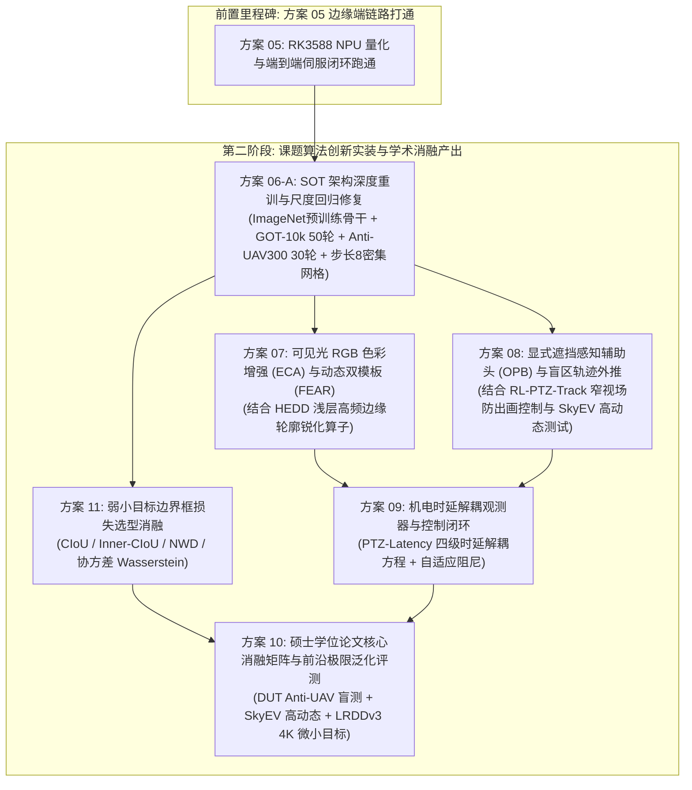

# 方案 06：后续创新规划（硕士课题算法深度创新与论文消融总控方案）

> **方案编号**：06（接力演进与学术深化总控方案）  
> **归属工程**：[RGB_PTZ_Integrated](file:///d:/PyProjects/RGB_PTZ_Integrated)  
> **前置依赖**：[05_光电跟踪系统RK3588边缘端量化与工程移植实操方案.md](file:///d:/PyProjects/RGB_PTZ_Integrated/待执行方案/05_光电跟踪系统RK3588边缘端量化与工程移植实操方案.md)（已在 RK3588 真机跑通基础检测/跟踪与机电伺服闭环）  
> **学术依据**：[《反无人机云台视觉跟踪与抗遮挡重检测课题规划指南》](file:///d:/PyProjects/RGB_PTZ_Integrated/课题/反无人机云台视觉跟踪与抗遮挡重检测课题规划指南.md)、[《轻量级跟踪基线实验分析与Rep-LightBackbone立项论证》](file:///d:/PyProjects/RGB_PTZ_Integrated/课题/轻量级跟踪基线实验分析与Rep-LightBackbone立项论证.md)  
> **计算平台**：RTX 4080 Super 台式机（16GB GDDR6X 显存，10,240 CUDA 核心）  
> **当前状态**：⚪ **规划储备 (Planned - 待方案 05 部署验证后激活)**  

---

## 一、 方案定位与执行逻辑

本方案承接方案 01~05 走通的工程基线。在完成软硬件全链路“Tracer Bullet”极简打通（视频流采集 -> 基础轻量检测/跟踪 -> AMFT 状态机 -> 云台机电闭环 -> RK3588 边缘端整体验收）后，以此方案作为接力跳板，在已走通硬件链路的活系统上，系统推进课题的核心算法创新、两阶段模型重训、多分支消融实验与学术成果转化。

> **工程储备与论文撰写原则**：本方案规划的所有改进方向（重训架构、损失函数候选池、边缘锐化、时延解耦等）均作为前期完备准备的工程实验储备库（Research Reserves）。后续在实验阶段按需尝试验证；**最终写入硕士学位论文的，仅且必须是实测确认对提升性能真正有帮助的有效机制**，并在论文中正常验证其有效性；未选中的候选路线属于工程内部储备，不写入论文正文。

---

## 二、 核心演进路线

---

## 三、 专项规划 06-A：SOT 架构深度重训与尺度回归修复

### 3.1 预训练骨干与网络拓扑重构
1. **骨干网络**：采用 RepVGG-A0（加载官方 ImageNet-1k 预训练权重），训练阶段利用多分支拓扑捕获丰富特征，推理态一键折叠为单路 $3\times 3$ 深度可分离卷积，保障单帧推理 $\le 2.0\text{ ms}$；
2. **步长优化与密集网格监督**：将网络有效步长由 16 降为 8（搜索特征图尺寸由 $16\times 16$ 扩充为 $32\times 32$），使微小无人机正样本网格点增加 4 倍，消除尺度欠拟合；
3. **Centerness 质量预测分支**：在 DAC-Head 预测头增加 1 通道中心度预测，推理时采用分类得分与中心度联合乘积排序：
   $$\text{Score}(x, y) = \sqrt{\text{Cls}(x, y) \times \text{Centerness}(x, y)}$$
4. **尺度坐标指数映射与损失函数接口**：
   采用指数映射避免零点截断：$\text{offset} = \exp(\text{pred}) \times \text{stride}$；总损失函数为：
   $$\mathcal{L}_{\text{total}} = \mathcal{L}_{\text{cls}} + \lambda_{\text{giou}} \mathcal{L}_{\text{GIoU}} + \lambda_{\text{cen}} \mathcal{L}_{\text{cen}}$$
   并在训练代码中采用插件化损失接口，预留挂载方案 11 候选损失的能力。

### 3.2 三阶段重训与盲测流水线
1. **阶段一（骨干预训练初始化）**：加载官方 `model.safetensors`（36.5 MB）；
2. **阶段二（通用单目标跟踪预训练）**：中科院 GOT-10k 数据集（50 轮，批大小 64，单轮 60,000 对样本切片，前 10 轮冻结骨干，后 40 轮解冻余弦退火，预估耗时 15~24 小时）；
3. **阶段三（地对空领域微调）**：CASIA Anti-UAV300 连续长焦飞行航迹（30 轮，初始学习率 $2\times 10^{-4}$ 余弦退火至 $1\times 10^{-6}$，预估耗时 4~8 小时）；
4. **阶段四（原生基石基准盲测闭环）**：在本地 DUT Anti-UAV（IEEE T-ITS 2022）20 组真机长焦航迹（24,784 帧）上执行无干预盲测打点（目标 Success AUC $\ge 58.0\%$，DP@20 $\ge 75.0\%$）。

---

## 四、 专项规划 11：弱小目标边界框损失函数选型与消融探索

在 DUT Anti-UAV 基准上开展候选损失函数单变量消融横向对拍（实测驱动选型，哪个效果好就采用哪个）：
1. **候选 1：标准 CIoU（基准对照组）**
   $$\mathcal{L}_{\text{CIoU}} = 1 - \text{IoU} + \frac{\rho^2(b, b^{gt})}{c^2} + \alpha v$$
2. **候选 2：Inner-CIoU（辅助边界框自适应缩放）**
   引入比例因子 $\text{ratio} > 1$ 放大感受范围，为微小目标提供平滑加速回归梯度；
3. **候选 3：NWD（Normalized Wasserstein Distance 归一化高斯瓦瑟斯坦距离）**
   建模为二维高斯分布，完全不交叠时仍提供严格平滑的导数梯度；
4. **候选 4：混合加权损失 (借鉴 UAV-DETR)**
   $$\mathcal{L}_{\text{box}} = \lambda_1 \mathcal{L}_{\text{Inner-CIoU}} + \lambda_2 \mathcal{L}_{\text{NWD}}$$
5. **候选 5：带协方差对齐的尺度感知 Wasserstein 损失（借鉴 Dist-Tracker CVPR 2025）**
   协方差矩阵显式编码飞行中的姿态机动角与宽高比偏差，对非对称几何形变具备强定向约束能力。

---

## 五、 专项规划 07~10：多模态表征、控制闭环与学术大表

* **方案 07（色彩空间与轮廓增强）**：嵌入轻量 ECA 增强空域红绿/蓝黄对抗色彩；可选融入 HEDD (2026) Edge-Aware 浅层边缘轮廓定向锐化算子；引入 FEAR 门控双模板机制（静态首帧锚点 + 动态 EMA 记忆），兼顾姿态形变适应与抗背景污染；
* **方案 08（显式遮挡感知与时序外推）**：特征交互后接入 OPB 辅助头输出遮挡度 $P_{occ}$；联动 Tiny-GRU/1D-CNN 在全遮挡期间驱动云台盲区匀速外推；吸收 RL-PTZ-Track (2024) 窄视场防出画控制策略，并在 SkyEV (2026) 高动态相机机动序列上验证扰动下的航迹维持能力；
* **方案 09（机电时延解耦与自适应伺服）**：吸收《PTZ-Latency-Study》(2024/2025) 延迟解耦建模方法，将视频解码延迟、推理时延与电机响应滞后显式纳入卡尔曼状态观测器，补偿机电伺服延迟与搜索框预测，结合自适应角速度阻尼，对齐 Ground-Visual-Edge (Sensors 2026) 边缘端低功耗部署标准；
* **方案 10（消融实验与权威泛化评测）**：以大连理工大学 DUT Anti-UAV (IEEE T-ITS 2022) 20 组真机长焦长时序列与 CASIA Anti-UAV300 连续航迹为主评测基准，引入 SkyEV (2026) 高动态极限序列与 LRDDv3 (ICRA 2026) 4K 超远距离微小目标序列执行横向泛化评估；产出学位论文所需的 Success/Precision 曲线与学术三线对比表。
