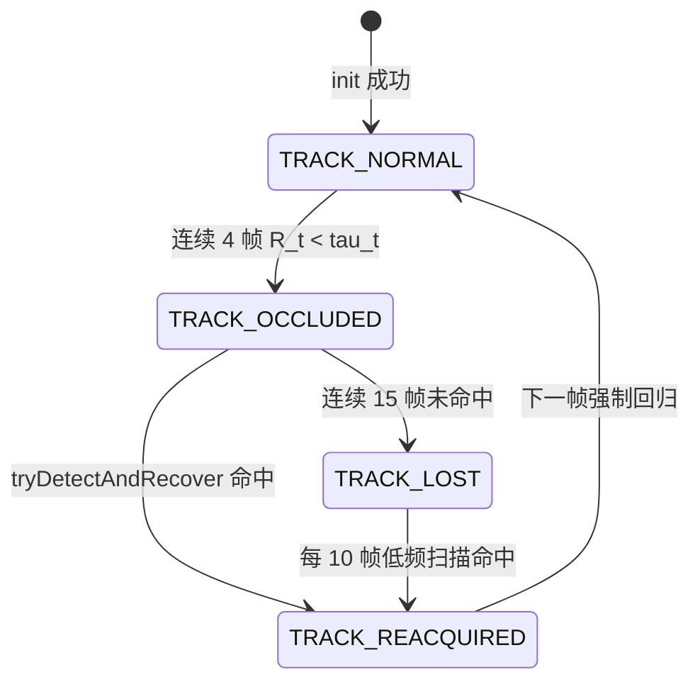
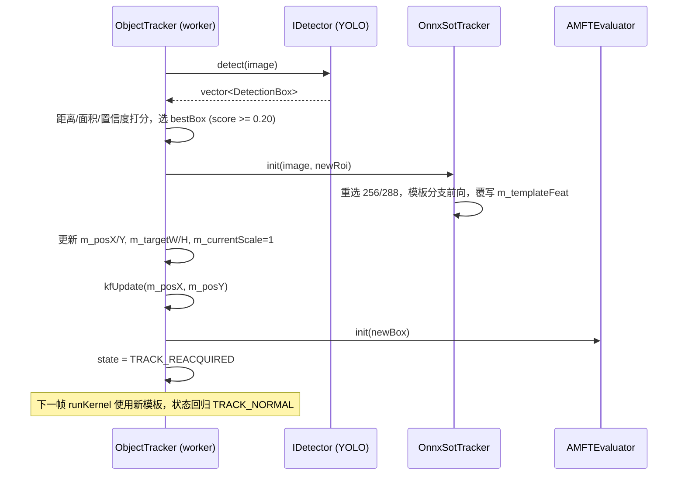

# Qt上位机嵌入LightTrack轻量单目标跟踪算法执行方案

> **文件性质**：工程实施方案与代码接线规范  
> **归属工程**：[RGB_PTZ_Integrated](file:///d:/PyProjects/RGB_PTZ_Integrated)  
> **基准输入**：[Qt上位机嵌入LightTrack跟踪算法任务书.md](file:///d:/PyProjects/RGB_PTZ_Integrated/待执行方案/Qt上位机嵌入LightTrack跟踪算法任务书.md)  
> **算法事实源**：`D:\PyProjects\SOT_Tracking_Baselines\algorithms\LightTrack\lib\tracker\lighttrack.py`、`evaluation\trackers\lighttrack_adapter.py`、`evaluation\metrics.py`、`evaluation\run_eval.py`、`experiments\test\OTB\LightTrack.yaml`

---

## 零、实测基准事实（2026-11-14 打点）

### 0.1 网络张量形状（`LightTrackM_Subnet`，stride=16，加载 `LightTrackM.pth`，missing keys = 0）

| 输入 | 输出 |
| :--- | :--- |
| 模板 `[1,3,127,127]` | `zf = [1,96,8,8]` |
| 搜索 `[1,3,255,255]` / `[1,3,256,256]` | `cls [1,1,16,16]`，`reg [1,4,16,16]` |
| 搜索 `[1,3,288,288]` | `cls [1,1,18,18]`，`reg [1,4,18,18]` |

### 0.2 基准评测所用超参数（OTB 配置 + adapter 覆写）

| 参数 | 值 | 来源 |
| :--- | :--- | :--- |
| `exemplar_size` | 127 | `Config(even=0)` |
| `instance_size` | 目标面积/图像面积 < 0.004 时 288，否则 256 | `LightTrack.yaml: big_sz / small_sz` |
| `total_stride` | 16 | adapter |
| `score_size` | `round(instance_size / 16)` → 16 或 18 | `Config.renew()` |
| `context_amount` | 0.5 | `Config` |
| `penalty_k` | 0.15 | yaml / adapter |
| `window_influence` | 0.45 | yaml / adapter |
| `lr` | 0.35 | yaml / adapter |
| 输入归一化 | RGB，`x/255`，减 ImageNet 均值 `(0.485,0.456,0.406)`，除标准差 `(0.229,0.224,0.225)` | `Lighttrack.normalize` |

### 0.3 Anti-UAV 20 组序列 `instance_size` 分布

按首帧 GT 面积比计算：**15 组使用 288**（video02/04/05/06/09/10/12/13/14/15/16/17/18/19/20），**5 组使用 256**（video01/03/07/08/11）。

### 0.4 基准指标（`SOT_Tracking_Baselines/results/benchmark_summary.csv`，LightTrackM 行）

| AUC | DP@20 | Mean CLE | Lost Rate | SR@0.50 | SR@0.75 | Latency | FPS |
| :---: | :---: | :---: | :---: | :---: | :---: | :---: | :---: |
| 52.24% | 66.06% | 131.49 px | 14.16% | 64.98% | 41.68% | 26.88 ms | 37.2 |

Latency/FPS 的计时区间为 `run_eval.py` 中 `cv2.imread + tracker.track` 全循环（含磁盘读取与 Python 前后处理），不是纯模型前向耗时。任务书所列“纯模型推理 2.1 ms”由本方案 Phase 2 的 C++ 工具实测确认。

### 0.5 与任务书张量规格的差异处置

任务书 1.3 节定义单一搜索输入 `[1,3,255,255]` → `[1,1,16,16]`。该规格无法复现 0.4 节基准（15/20 序列使用 288）。本方案采用**双静态搜索图**：

| 文件 | 搜索输入 | 输出 |
| :--- | :--- | :--- |
| `models/lighttrack_search_256.onnx` | `[1,3,256,256]` | `cls_score [1,1,16,16]`，`reg_dist [1,4,16,16]` |
| `models/lighttrack_search_288.onnx` | `[1,3,288,288]` | `cls_score [1,1,18,18]`，`reg_dist [1,4,18,18]` |

两个文件均为纯静态 opset 17 计算图，满足 DirectML 与 RKNN 直通契约；初始化时按 0.2 节面积比规则选择其一，跟踪期间不切换。

---

## 一、Phase 0：LightTrack 纯静态 ONNX 导出

### 1.1 权重归档

```
复制：D:\PyProjects\SOT_Tracking_Baselines\checkpoints\lighttrack\LightTrackM.pth
  →  weights/sot/lighttrack_m.pth
```

### 1.2 导出脚本 `scripts/export_lighttrack_onnx.py`

归一化与 sigmoid 固化进计算图，C++ 侧输入保持任务书约定的 `[0,1]` RGB 浮点张量，`cls_score` 输出为 sigmoid 概率。

```python
import os, sys, torch, torch.nn as nn
LT = r"D:\PyProjects\SOT_Tracking_Baselines\algorithms\LightTrack"
sys.path.insert(0, LT)
import lib.models.models as models
from lib.utils.utils import load_pretrain

PATH_NAME = "back_04502514044521042540+cls_211000022+reg_100000111_ops_32"
MEAN = torch.tensor([0.485, 0.456, 0.406]).view(1, 3, 1, 1)
STD  = torch.tensor([0.229, 0.224, 0.225]).view(1, 3, 1, 1)

class TemplateBranch(nn.Module):
    def __init__(self, net):
        super().__init__(); self.net = net
        self.register_buffer("mean", MEAN); self.register_buffer("std", STD)
    def forward(self, template_img):                     # [1,3,127,127], RGB, [0,1]
        return self.net.features((template_img - self.mean) / self.std)   # [1,96,8,8]

class SearchBranch(nn.Module):
    def __init__(self, net):
        super().__init__(); self.net = net
        self.register_buffer("mean", MEAN); self.register_buffer("std", STD)
    def forward(self, search_img, template_feat):
        xf = self.net.features((search_img - self.mean) / self.std)
        zf, xf = self.net.neck(template_feat, xf)
        oup = self.net.head(self.net.feature_fusor(zf, xf))
        return torch.sigmoid(oup["cls"]), oup["reg"]

def main():
    net = models.__dict__["LightTrackM_Subnet"](PATH_NAME, stride=16)
    net = load_pretrain(net, "weights/sot/lighttrack_m.pth", print_unuse=False).eval()
    torch.onnx.export(TemplateBranch(net).eval(), torch.rand(1, 3, 127, 127),
                      "models/lighttrack_template.onnx", opset_version=17,
                      input_names=["template_img"], output_names=["template_feat"])
    for xs in (256, 288):
        torch.onnx.export(SearchBranch(net).eval(),
                          (torch.rand(1, 3, xs, xs), torch.rand(1, 96, 8, 8)),
                          f"models/lighttrack_search_{xs}.onnx", opset_version=17,
                          input_names=["search_img", "template_feat"],
                          output_names=["cls_score", "reg_dist"])

if __name__ == "__main__":
    main()
```

执行环境：`D:\miniconda3\envs\anti_uav_yolo\python.exe`，工作目录为工程根目录。

### 1.3 导出校验 `scripts/verify_lighttrack_onnx.py`

1. **签名校验**：`onnxruntime.InferenceSession` 打印全部输入/输出名称与形状，须与 0.5 节表格一致，且不含任何动态维度（`dim_param`）。
2. **算子校验**：遍历 `onnx.load(...).graph.node`，输出算子类型集合，确认不含 `Loop`/`Scan`/`If`/非标准域算子。
3. **数值对齐**：同一随机输入下，PyTorch 原网络（`net.template` + `net.track` + 外置归一化与 sigmoid）与 ONNX Runtime CPU EP 输出逐元素比较：`template_feat` 最大绝对误差 < 1e-5，`cls_score` / `reg_dist` 最大绝对误差 < 1e-4。
4. **Python-ONNX 全量回归**：编写 `scripts/eval_lighttrack_onnx.py`，用 ONNX Runtime 替换 `net.template/track`，其余逻辑逐行复用 `lighttrack.py`，在 20 组序列按 `run_eval.py` 协议评测，AUC / DP@20 / Lost Rate 与 0.4 节基准绝对差均 ≤ 0.1%。该结果作为 C++ 实现的直接对齐目标。

---

## 二、任务 1：C++ 深度跟踪引擎 `OnnxSotTracker`

### 2.1 类声明（`onnxsottracker.h`）

```cpp
#ifndef ONNXSOTTRACKER_H
#define ONNXSOTTRACKER_H

#include <opencv2/core.hpp>
#include <QString>
#include <vector>
#include <mutex>

struct OrtApi; struct OrtEnv; struct OrtSession;
struct OrtSessionOptions; struct OrtMemoryInfo;

struct SotKernelResult {
    bool valid = false;
    cv::Rect2f bbox;           // 原图像素 (x, y, w, h)
    cv::Point2f center;        // 原图像素中心
    float confidence = 0.0f;   // 峰值位置 sigmoid 分类概率 cls[r_max, c_max]，[0,1]
};

struct SotTrackerConfig {
    QString templateModel = "models/lighttrack_template.onnx";
    QString searchModelSmall = "models/lighttrack_search_256.onnx";
    QString searchModelBig   = "models/lighttrack_search_288.onnx";
    bool useGpu = true;
    int deviceId = 0;
    float penaltyK = 0.15f;
    float windowInfluence = 0.45f;
    float lr = 0.35f;
    float contextAmount = 0.5f;
    float bigSzAreaRatio = 0.004f;
};

class OnnxSotTracker {
public:
    OnnxSotTracker();
    ~OnnxSotTracker();
    OnnxSotTracker(const OnnxSotTracker&) = delete;
    OnnxSotTracker& operator=(const OnnxSotTracker&) = delete;

    bool loadModel(const SotTrackerConfig& cfg = SotTrackerConfig());
    bool isLoaded() const;
    bool init(const cv::Mat& bgr, const cv::Rect2f& bbox);   // 模板分支单次前向
    SotKernelResult track(const cv::Mat& bgr);              // 搜索分支逐帧前向
    bool isInitialized() const;
    bool isUsingGpu() const;
    float lastModelMs() const;      // 搜索分支 Run() 纯前向耗时
    float lastTotalMs() const;      // track() 含前后处理总耗时
    int instanceSize() const;       // 当前序列使用的 256 / 288

private:
    struct SearchNet {
        OrtSession* session = nullptr;
        int inSize = 0, scoreSize = 0;
        char* inName0 = nullptr;  char* inName1 = nullptr;
        char* outName0 = nullptr; char* outName1 = nullptr;
        std::vector<float> gridX, gridY, window;   // scoreSize² 预计算
    };

    bool createSession(const QString& path, OrtSession** out);
    bool initSearchNet(const QString& path, SearchNet& net);
    void releaseAll();
    void cropPatch(const cv::Mat& rgb, cv::Point2f pos, int originalSz, int modelSz, cv::Mat& out) const;
    void toNCHW(const cv::Mat& rgbPatch, std::vector<float>& dst) const;
    static float sizeWithContext(float w, float h);   // sqrt((w+p)(h+p)), p=(w+h)/2
    static double pyRound(double v);                   // Python2 round：四舍五入远离 0

    const OrtApi* m_api = nullptr;
    OrtEnv* m_env = nullptr;
    OrtSessionOptions* m_opts = nullptr;
    OrtMemoryInfo* m_memInfo = nullptr;
    OrtSession* m_tmplSession = nullptr;
    char* m_tmplInName = nullptr;  char* m_tmplOutName = nullptr;
    SearchNet m_small, m_big;
    SearchNet* m_active = nullptr;

    SotTrackerConfig m_cfg;
    bool m_loaded = false, m_initialized = false, m_usingGpu = false;
    std::vector<float> m_templateFeat;          // 96*8*8 = 6144
    std::vector<float> m_tmplInput, m_srchInput;
    cv::Scalar m_avgChans;                      // init 帧 RGB 全图通道均值
    cv::Point2f m_pos;                          // target_pos
    cv::Size2f m_sz;                            // target_sz
    int m_imW = 0, m_imH = 0;
    float m_lastModelMs = 0.0f, m_lastTotalMs = 0.0f;
    mutable std::mutex m_mutex;
};

#endif
```

### 2.2 Session 生命周期

| 阶段 | 操作 |
| :--- | :--- |
| `loadModel` | `OrtGetApiBase()->GetApi(ORT_API_VERSION)` → `CreateEnv` → `CreateSessionOptions`（`SetIntraOpNumThreads=1`，`ORT_ENABLE_ALL`，`useGpu` 时 `OrtSessionOptionsAppendExecutionProvider_DML(opts, deviceId)`，失败回退 CPU 并置 `m_usingGpu=false`）→ 依次创建模板、256、288 三个 Session（共享同一 Env 与 SessionOptions）→ 查询节点名（`_strdup` 拷贝后 `allocator->Free`）与形状并逐项校验 → `CreateCpuMemoryInfo(OrtArenaAllocator, OrtMemTypeDefault)` → 预分配输入缓冲与网格/窗表 |
| `init` | 运行模板 Session，输出拷贝至 `m_templateFeat`，按面积比选定 `m_active` |
| `track` | 运行 `m_active` Session，输入为搜索块与 `m_templateFeat` |
| `releaseAll`（析构及重载时） | `free` 全部节点名 → `ReleaseSession`（288、256、模板）→ `ReleaseMemoryInfo` → `ReleaseSessionOptions` → `ReleaseEnv` → 指针置空 |

三个 Session 常驻，YOLO 重捕触发模板重算时不重建 Session。MinGW 编译 `dml_provider_factory.h` 前定义空宏 `_Maybenull_`、`_Maybenull_string_`，与 [onnxdetector.cpp](file:///d:/PyProjects/RGB_PTZ_Integrated/onnxdetector.cpp) 一致。

### 2.3 前处理（逐行对齐 `lighttrack.py` 与 `get_subwindow_tracking`）

**颜色空间**：`init` / `track` 入口先 `cv::cvtColor(bgr, rgb, COLOR_BGR2RGB)`，裁切、均值填充均在 RGB 上执行。

**通道均值**：`init` 时 `m_avgChans = cv::mean(rgb)`，跟踪期间不更新。

**上下文尺寸**（$w, h$ 为 `target_sz`，$c_a = 0.5$）：

$$w_z = w + c_a (w + h), \quad h_z = h + c_a (w + h), \quad s_z = \sqrt{w_z h_z}$$

- 模板裁切边长：$\text{round}(s_z)$（Python 3 `round`，银行家舍入；C++ 用 `std::nearbyint`，默认舍入模式 FE_TONEAREST 与之等价）。
- 搜索：$\text{scale}_z = 127 / s_z$，$\text{pad} = \dfrac{(I - 127)/2}{\text{scale}_z}$，$s_x = s_z + 2\,\text{pad}$，裁切边长 $\text{python2round}(s_x)$（四舍五入远离 0，`pyRound`），$I \in \{256, 288\}$。

**子窗口裁切 `cropPatch(rgb, pos, sz, modelSz)`**：

```
c      = (sz + 1) / 2.0
xmin   = pyRound(pos.x - c);   xmax = xmin + sz - 1
ymin   = pyRound(pos.y - c);   ymax = ymin + sz - 1
padL   = max(0, -xmin);        padT = max(0, -ymin)
padR   = max(0, xmax - W + 1); padB = max(0, ymax - H + 1)
若任一 pad > 0：copyMakeBorder(rgb 有效区, padT, padB, padL, padR, BORDER_CONSTANT, m_avgChans)
patch  = 区域 [ymin+padT, ymax+padT] × [xmin+padL, xmax+padL]
若 sz != modelSz：cv::resize(patch, out, Size(modelSz, modelSz), 0, 0, INTER_LINEAR)
```

实现时仅对裁切窗口与图像的交集做 `copyMakeBorder`，避免整幅 1080P 图像扩边拷贝。

**张量化 `toNCHW`**：`uint8 RGB` → `float/255` → 平面 NCHW；ImageNet 归一化已固化在 ONNX 图内。

### 2.4 后处理（逐行对齐 `Lighttrack.update`）

设 $S$ = score_size，$I$ = instance_size，`reg` 单位为**搜索块像素**。

**网格**（`grids()`）：

$$g_x[r][c] = (c - \lfloor S/2 \rfloor) \cdot 16 + \lfloor I/2 \rfloor, \quad g_y[r][c] = (r - \lfloor S/2 \rfloor) \cdot 16 + \lfloor I/2 \rfloor$$

**预测框**（搜索块坐标）：

$$x_1 = g_x - \text{reg}_0,\; y_1 = g_y - \text{reg}_1,\; x_2 = g_x + \text{reg}_2,\; y_2 = g_y + \text{reg}_3$$

**尺度/比例惩罚**（$\tilde w, \tilde h$ 为 `target_sz` × scale_z；$\text{sz}(a,b) = \sqrt{(a + \tfrac{a+b}{2})(b + \tfrac{a+b}{2})}$；$\text{change}(r) = \max(r, 1/r)$）：

$$s_c = \text{change}\left(\frac{\text{sz}(x_2 - x_1,\, y_2 - y_1)}{\text{sz}(\tilde w, \tilde h)}\right), \quad r_c = \text{change}\left(\frac{\tilde w / \tilde h}{(x_2 - x_1)/(y_2 - y_1)}\right)$$

$$\text{penalty} = \exp\big(-(r_c s_c - 1)\, k\big), \quad k = 0.15$$

**余弦窗**：$\text{win} = \text{hann}_S \otimes \text{hann}_S$，$\text{hann}_S(n) = 0.5 - 0.5\cos\dfrac{2\pi n}{S-1}$（`np.hanning`），**不做归一化**。

**综合得分与峰值**：

$$\text{pscore} = (1 - \lambda)\cdot \text{penalty}\cdot \text{cls} + \lambda \cdot \text{win}, \quad \lambda = 0.45$$

$(r^*, c^*) = \arg\max \text{pscore}$（行优先首个最大值，与 `np.argmax` 一致）。

**位置与尺寸更新**：

$$\Delta x = \frac{\tfrac{x_1 + x_2}{2} - \lfloor I/2 \rfloor}{\text{scale}_z}, \quad \Delta y = \frac{\tfrac{y_1 + y_2}{2} - \lfloor I/2 \rfloor}{\text{scale}_z}$$

$$\hat w = \frac{x_2 - x_1}{\text{scale}_z}, \quad \hat h = \frac{y_2 - y_1}{\text{scale}_z}, \quad \eta = \text{penalty}^* \cdot \text{cls}^* \cdot 0.35$$

$$w' = \eta \hat w + (1 - \eta) w, \quad h' = \eta \hat h + (1 - \eta) h$$

$$w_{\text{new}} = (1 - \eta) w + \eta w', \quad h_{\text{new}} = (1 - \eta) h + \eta h'$$

（`lighttrack.py` 第 132–136 行两次混合，C++ 原样复现。）

$$\text{pos}_{\text{new}} = \text{pos} + (\Delta x, \Delta y)$$

**边界钳制**：$x \in [0, W]$，$y \in [0, H]$，$w \in [10, W]$，$h \in [10, H]$。

**输出**：`bbox = (x - w/2, y - h/2, w, h)`，`confidence = cls[r*, c*]`。

### 2.5 搜索图选择规则

`init()` 内：

```cpp
const float ratio = (bbox.width * bbox.height) / float(rgb.cols * rgb.rows);
m_active = (ratio < m_cfg.bigSzAreaRatio) ? &m_big : &m_small;
```

YOLO 重捕触发的 `init()` 按新框重新判定。

### 2.6 异常与线程安全

| 项目 | 规范 |
| :--- | :--- |
| `OrtStatus*` | 每次调用检查；非空时 `GetErrorMessage` 写入 `qWarning`，`ReleaseStatus`，函数返回失败 |
| `OrtValue` | 每帧创建的输入/输出张量在函数退出前全部 `ReleaseValue`，采用局部 RAII 守卫（`std::unique_ptr<OrtValue, Deleter>`） |
| 并发 | 公开方法持 `m_mutex`；实例仅由 `ObjectTracker` 所在 worker 线程调用 |
| 数值 | 回归量、`pos`、`sz` 出现 NaN/Inf 时本帧返回 `valid=false`，保持上一帧状态 |
| 输入 | 空图像、`bbox` 宽高 < 4 时 `init` 返回 `false` |

---

## 三、任务 2：跟踪内核抽象与双引擎切换

### 3.1 枚举（`objecttracker.h`）

```cpp
enum class TrackingKernel { KERNEL_DSST = 0, KERNEL_LIGHTTRACK = 1 };
Q_DECLARE_METATYPE(TrackingKernel)
```

### 3.2 ObjectTracker 成员与接口

```cpp
public:
    void setTrackingKernel(TrackingKernel k);       // 仅在 init 前调用
    TrackingKernel trackingKernel() const { return m_kernel; }
    void setSotEngine(const std::shared_ptr<OnnxSotTracker>& e) { m_sot = e; }  // 控制器注入共享引擎
    bool loadSotModel(const SotTrackerConfig& cfg); // m_sot 为空时在 worker 线程内创建并加载
private:
    struct KernelOutput {
        bool valid = false;
        cv::Point2f center;
        float scale = 1.0f;       // 当前尺寸 / 初始化尺寸
        float psrForAmft = 0.0f;  // 统一送入 AMFTEvaluator::evaluate 的 psr 参数
        float rawScore = 0.0f;    // DSST: PSR；LightTrack: cls 峰值
    };
    KernelOutput runKernel(const cv::Mat& bgr);
    bool reinitKernel(const cv::Mat& bgr, const cv::Rect& roi);

    TrackingKernel m_kernel = TrackingKernel::KERNEL_DSST;
    std::shared_ptr<OnnxSotTracker> m_sot;
```

尺寸统一：LightTrack 输出的 `w, h` 写回 `m_currentScale = w / m_targetW`（LightTrack 独立估计宽高比，`m_targetH` 同步按 `h / m_currentScale` 更新），使 `update()` 末尾 `bbox = (m_posX - W·s/2, …)` 构建逻辑及 `getCurrentBBox()` 保持不变。

### 3.3 分派改造点（[objecttracker.cpp](file:///d:/PyProjects/RGB_PTZ_Integrated/objecttracker.cpp)）

| 位置 | 现状 | 改为 |
| :--- | :--- | :--- |
| `init()` L103 | `m_core.init(image, roi)` | `reinitKernel(image, roi)` |
| `tryDetectAndRecover()` L365 | `m_core.init(image, newRoi)` | `reinitKernel(image, newRoi)` |
| Mode A（`!m_redetectionEnabled`）L541–555 | `m_core.update` + `computePSR` | `runKernel(image)`；`psr` 取 `rawScore`；LightTrack 内核下 PSR 基线判丢改用 cls 峰值基线（同一 30 帧均值、0.75 倍门限逻辑） |
| Mode A 遮挡分支 `reDetect()` L519 | 九宫格 `m_core.detectOnly` | LightTrack 内核下改为对 KF 预测中心执行一次 `m_sot->track` 预览（不写回状态的 `peek` 接口），cls 峰值 > 0.8 × 基线判定恢复 |
| Mode B L688–701 | `m_core.update` + `computePSR` | `runKernel(image)`，`evaluate(ko.psrForAmft, ko.valid, evalBox, image)` |
| `setLearningFrozen(true/false)` | DSST 冻结模板学习 | LightTrack 模板固定不在线更新，调用保留且仅作用于 DSST |
| `modelSize()` | `m_core.modelSize()` | LightTrack 内核返回 `"LightTrack-<instanceSize>"` |

`OnnxSotTracker` 需额外提供 `SotKernelResult peek(const cv::Mat& bgr, cv::Point2f center) const`：以给定中心执行一次搜索前向，返回结果但不修改 `m_pos/m_sz`。

### 3.4 切换生命周期

`ObjectTracker` 实例随每次 `TrackingController::setTarget()` 新建、随 `stopTracking()` 销毁（[trackingcontroller.cpp](file:///d:/PyProjects/RGB_PTZ_Integrated/trackingcontroller.cpp) 现有逻辑）。内核切换采用“下一次框选生效”：

1. UI 选择内核 → `TrackingController::setTrackingKernel(k)` 仅记录 `m_kernel`；
2. 跟踪进行中切换：状态栏提示“新内核将在下次框选时生效”，当前跟踪不中断；
3. `setTarget()` 新建 `ObjectTracker` 后、`moveToThread` 前调用 `setTrackingKernel(m_kernel)`；
4. `initSlot` 在 worker 线程内：若 `m_kernel == KERNEL_LIGHTTRACK` 且 `m_sot` 未加载，先 `loadSotModel()` 再 `init()`；加载失败时 `initDone(false, "LightTrack 模型加载失败")`，控制器回到 `Idle`。

Session 创建（约数百毫秒，DirectML 首次编译）发生在 worker 线程，不阻塞 UI。为避免每次框选重复创建 Session，`TrackingController` 持有 `std::shared_ptr<OnnxSotTracker> m_sotShared`，首次加载后注入后续 `ObjectTracker`（与 `m_detector` 注入模式一致）：控制器在首次选择 LightTrack 时 `std::make_shared<OnnxSotTracker>()` 创建未加载实例并经 `setSotEngine()` 注入，`initSlot` 在 worker 线程内检查 `isLoaded()`，未加载时执行 `loadModel()`；后续框选复用已加载实例。同一时刻仅一个 `ObjectTracker` 存活（`setTarget` 先销毁旧实例），共享实例不存在并发调用。

### 3.5 TrackingController 接口

```cpp
void setTrackingKernel(TrackingKernel k);
TrackingKernel trackingKernel() const;
```

飞行记录 CSV 的 `mode` 字段扩展为 `<MOT_AI|SOT_PURE>_<DSST|LT>`，`psr` 列记录 `rawScore`。

### 3.6 MainWindow UI

- [mainwindow.ui](file:///d:/PyProjects/RGB_PTZ_Integrated/mainwindow.ui) 在 `comboAiModel` 同组新增 `comboTrackKernel`：索引 0 = `DSST`，索引 1 = `LightTrack (DirectML)`。
- `on_comboTrackKernel_currentIndexChanged(int)` → `m_trackingController->setTrackingKernel(...)`，`ConfigManager` 持久化键 `tracking/kernel`，启动时恢复。
- `refreshModelList()` 过滤规则在 `sot_` 前缀基础上增加 `lighttrack_` 前缀，保证 SOT 模型不出现在 YOLO 下拉框。

---

## 四、任务 3：置信度与 AMFT 协同接线

### 4.1 归一化协议

[AMFTEvaluator::computeSConf](file:///d:/PyProjects/RGB_PTZ_Integrated/amftevaluator.cpp#L57-L64) 将 `psr` 线性映射：$S_{conf} = \text{clamp}((psr - 5)/20,\ 0,\ 1)$。

| 内核 | `psrForAmft` | 得到的 $S_{conf}$ |
| :--- | :--- | :--- |
| DSST | `computePSR(response)` 原值 | 与现状一致 |
| LightTrack | $5 + 20 \cdot \text{cls}^*$ | $= \text{cls}^*$ |

`AMFTEvaluator` 代码不修改；$S_{mot}$、$S_{bg}$ 仅依赖目标框与图像，与内核无关。

### 4.2 阈值标定

AMFT 默认参数（$\tau_0 = 0.65$，$\alpha = 0.5$，权重 0.45/0.35/0.20）针对 DSST 标定。LightTrack 的 cls 峰值分布不同，Phase 2 由 `test_sot_tracker` 输出逐帧 `cls*`、$S_{mot}$、$S_{bg}$、$R_t$、IoU 至 CSV，统计 IoU>0.5 与 IoU=0 两类帧的 $R_t$ 分布，确定 LightTrack 专用 $\tau_0$；`ObjectTracker` 按内核类型调用 `m_evaluator.setTau0()`。未完成标定前沿用 0.65。

### 4.3 状态流转（复用现有四态，逻辑不改）



### 4.4 YOLO 重捕与模板重算时序



变焦联动 `triggerScaleCalibration()` → 下一帧 `tryDetectAndRecover()` → `reinitKernel()`，LightTrack 路径同样完成模板与搜索图尺寸重选。

---

## 五、任务 4：离线验证工具 `tools/test_sot_tracker.cpp`

### 5.1 评测协议（逐项对齐 `run_eval.py` / `metrics.py`）

| 项 | 规则 |
| :--- | :--- |
| 序列 | `datasets/Anti-UAV/tracking/Anti-UAV-Tracking-V0/video01..video20`，帧按文件名排序 |
| 真值 | `Anti-UAV-Tracking-V0GT/videoXX_gt.txt`，逗号或空格分隔 `x,y,w,h` |
| 帧数 | `n = min(帧数, GT 行数)` |
| 初始化 | 第 0 帧 + GT[0]；第 0 帧预测记为 GT[0] |
| 跟踪 | 第 1..n-1 帧逐帧 `track()` |
| 有效帧 | 仅统计 GT `w>0 && h>0` 的帧（含第 0 帧） |
| AUC | 全序列合并的 IoU 数组，阈值 `linspace(0,1,21)`，成功率取均值 |
| DP@20 | CLE ≤ 20 px 的帧比例 |
| Mean CLE | 中心欧氏距离均值 |
| Lost Rate | IoU == 0 的帧比例 |
| SR@0.50 / SR@0.75 | IoU ≥ 0.5 / 0.75 的帧比例 |

### 5.2 计时与资源

| 指标 | 定义 |
| :--- | :--- |
| 纯模型前向 | 搜索分支 `Run()` 前后 `std::chrono::steady_clock`，取均值 / P50 / P99 |
| 模板前向 | 模板分支 `Run()` 耗时，每序列 1 次 |
| 单帧处理 | `track()` 全过程（裁切 + 张量化 + 前向 + 解码） |
| 端到端 FPS | 含 `cv::imread` 的循环总帧数 / 总耗时（与 0.4 节基准计时口径一致） |
| 内存 | Windows `GetProcessMemoryInfo` 的 `WorkingSetSize`、`PrivateUsage`：加载后、第 1 序列后、全部结束后三点采样 |
| 预热 | 正式计时前对 256、288 两个 Session 各执行 20 次前向 |

### 5.3 输出

1. 控制台：逐序列 `帧数 | instance_size | AUC | DP@20 | CLE | Lost | 模型 ms | 端到端 FPS`，以及全局汇总；
2. `results/cpp_lighttrack/per_frame.csv`：`seq,frame,x,y,w,h,cls,iou,cle,model_ms,total_ms`；
3. `results/cpp_lighttrack/summary.csv`：列名与 `benchmark_summary.csv` 一致，便于并表；
4. 命令行参数：`--gpu/--cpu`、`--seq videoXX`（单序列调试）、`--amft`（同时运行 AMFTEvaluator 并输出 4.2 节标定所需列）。

### 5.4 构建

工具不进入主工程 `.pro`，新增 `tools/test_sot_tracker.pro`：

```pro
QT += core
CONFIG += console c++17
CONFIG -= app_bundle
TARGET = test_sot_tracker
DESTDIR = $$PWD/../build/release
SOURCES += test_sot_tracker.cpp ../onnxsottracker.cpp
HEADERS += ../onnxsottracker.h
INCLUDEPATH += $$PWD/.. $$PWD/../opencv/install/include $$PWD/../3rdparty/onnxruntime/include
LIBS += -L$$PWD/../opencv/install/x64/mingw/lib -lopencv_core4100 -lopencv_imgproc4100 -lopencv_imgcodecs4100
LIBS += -L$$PWD/../3rdparty/onnxruntime/lib -lonnxruntime -lDirectML -lpsapi
DEFINES += USE_ONNXRUNTIME
```

运行脚本 `run_test_sot.ps1`（结构同根目录 `run_test.ps1`），工作目录为工程根目录。

---

## 六、任务 5：工程文件变动清单

### 6.1 新增

| 文件 | 内容 |
| :--- | :--- |
| `weights/sot/lighttrack_m.pth` | 官方权重归档 |
| `scripts/export_lighttrack_onnx.py` | 双分支三文件导出 |
| `scripts/verify_lighttrack_onnx.py` | 签名、算子、数值对齐校验 |
| `scripts/eval_lighttrack_onnx.py` | Python + ONNX Runtime 全量回归 |
| `models/lighttrack_template.onnx` | 模板分支 |
| `models/lighttrack_search_256.onnx` | 搜索分支（16×16） |
| `models/lighttrack_search_288.onnx` | 搜索分支（18×18） |
| `onnxsottracker.h` / `onnxsottracker.cpp` | C++ 深度跟踪引擎 |
| `tools/test_sot_tracker.cpp` / `tools/test_sot_tracker.pro` | 离线验证工具 |
| `run_test_sot.ps1` | 工具启动脚本 |

### 6.2 修改

| 文件 | 改动 |
| :--- | :--- |
| [objecttracker.h](file:///d:/PyProjects/RGB_PTZ_Integrated/objecttracker.h) | `TrackingKernel` 枚举、`KernelOutput`、`m_kernel`、`m_sot`、`setTrackingKernel`、`setSotEngine`、`runKernel`、`reinitKernel` |
| [objecttracker.cpp](file:///d:/PyProjects/RGB_PTZ_Integrated/objecttracker.cpp) | 3.3 节表格所列 7 处分派改造 |
| [trackingcontroller.h](file:///d:/PyProjects/RGB_PTZ_Integrated/trackingcontroller.h) / [.cpp](file:///d:/PyProjects/RGB_PTZ_Integrated/trackingcontroller.cpp) | `m_kernel`、`m_sotShared`、`setTrackingKernel`；`setTarget()` 注入；飞行记录 `mode` 字段扩展 |
| [mainwindow.ui](file:///d:/PyProjects/RGB_PTZ_Integrated/mainwindow.ui) / [mainwindow.h](file:///d:/PyProjects/RGB_PTZ_Integrated/mainwindow.h) / [mainwindow.cpp](file:///d:/PyProjects/RGB_PTZ_Integrated/mainwindow.cpp) | `comboTrackKernel` 控件与槽；`refreshModelList()` 增加 `lighttrack_` 前缀过滤 |
| [configmanager.h](file:///d:/PyProjects/RGB_PTZ_Integrated/configmanager.h) / [.cpp](file:///d:/PyProjects/RGB_PTZ_Integrated/configmanager.cpp) | `tracking/kernel` 读写 |
| [RGB_PTZ_Integrated.pro](file:///d:/PyProjects/RGB_PTZ_Integrated/RGB_PTZ_Integrated.pro) | `SOURCES += onnxsottracker.cpp`，`HEADERS += onnxsottracker.h` |

### 6.3 构建配置

主工程 `.pro` 无需新增库、宏或包含路径：ONNX Runtime / DirectML / OpenCV core+imgproc 链接已存在；`QMAKE_POST_LINK` 已将 `models/*.onnx` 复制至输出目录 `models/`。

### 6.4 模型路径解析

LightTrack 三个模型路径复用 `MainWindow::resolveModelPath()` 的候选目录规则（`models/`、`applicationDirPath()/models/` 及上级目录），由 `TrackingController` 解析为绝对路径后写入 `SotTrackerConfig`。

---

## 七、任务 6：实施阶段与验收矩阵

### 7.1 阶段顺序


| 阶段 | 进入条件 | 完成判据 |
| :---: | :--- | :--- |
| P0 | 权重归档 | 7.2 节 E1–E4 通过 |
| P1 | P0 完成 | 主工程与工具工程编译 0 错误 0 警告 |
| P2 | P1 完成 | 7.2 节 A1–A5、F1–F3、S1 通过；输出 LightTrack $\tau_0$ 标定值 |
| P3 | P2 完成 | 7.2 节 B1、U1–U3 通过；`run_test.ps1` / `test_amft` 回归不退化 |
| P4 | P3 完成 | 7.2 节 F4、S2、S3、U4 通过 |

每阶段完成后执行 `git commit` + `git push origin main`，并刷新 [checkpoint.md](file:///d:/PyProjects/RGB_PTZ_Integrated/checkpoint.md)。

### 7.2 验收指标矩阵

| 编号 | 维度 | 指标 | 通过标准 | 验证方式 |
| :---: | :--- | :--- | :--- | :--- |
| E1 | 导出 | 张量签名 | 与 0.5 节一致，无动态维度 | `verify_lighttrack_onnx.py` |
| E2 | 导出 | 算子集合 | 无控制流/自定义域算子 | `verify_lighttrack_onnx.py` |
| E3 | 导出 | 数值误差 | feat < 1e-5；cls/reg < 1e-4 | `verify_lighttrack_onnx.py` |
| E4 | 导出 | Python-ONNX 回归 | AUC/DP@20/Lost 与 0.4 节绝对差 ≤ 0.1% | `eval_lighttrack_onnx.py` |
| B1 | 编译 | 主工程 + 工具 | Release 0 错误 0 警告 | `qmake` + `mingw32-make` |
| A1 | 精度 | AUC | 与 E4 结果绝对差 ≤ 0.5%（基准 52.24%） | `test_sot_tracker` |
| A2 | 精度 | DP@20 | 与 E4 结果绝对差 ≤ 0.5%（基准 66.06%） | `test_sot_tracker` |
| A3 | 精度 | Mean CLE | 与 E4 结果相对差 ≤ 2%（基准 131.49 px） | `test_sot_tracker` |
| A4 | 精度 | Lost Rate | 与 E4 结果绝对差 ≤ 0.5%（基准 14.16%） | `test_sot_tracker` |
| A5 | 精度 | SR@0.50 / SR@0.75 | 与 E4 结果绝对差 ≤ 0.5% | `test_sot_tracker` |
| F1 | 性能 | 搜索分支纯前向 | 均值 ≤ 2.5 ms（DirectML，256 与 288 分别统计） | `test_sot_tracker` |
| F2 | 性能 | 模板分支前向 | 单次 ≤ 5 ms（预热后） | `test_sot_tracker` |
| F3 | 性能 | 单帧 `track()` 总耗时 | P99 ≤ 10 ms（1080P 输入） | `test_sot_tracker` |
| F4 | 性能 | 整机帧率 | 跟踪处理 ≥ 60 FPS（离线视频源）；实时相机 25 fps 输入下零积压丢帧 | 上位机日志 `result.fps` 与背压丢帧计数 |
| S1 | 稳定 | 离线内存 | 20 序列跑完 WorkingSet 相对首序列后增量 < 5 MB | `test_sot_tracker` |
| S2 | 稳定 | 长稳 | 连续跟踪 2 h，进程内存与 GPU 专用显存无单调增长 | 任务管理器 / `nvidia-smi` 采样 |
| S3 | 稳定 | 反复框选 | 连续 200 次框选-停止循环无崩溃、无 Session 泄漏 | 手动 + 日志 |
| U1 | 功能 | 内核切换 | DSST ↔ LightTrack 切换后下一次框选使用新内核，日志 `modelInfo` 正确 | 手动 |
| U2 | 功能 | 模型列表 | `comboAiModel` 不含 `sot_*` / `lighttrack_*` | 手动 |
| U3 | 功能 | 配置持久化 | 重启后内核选择恢复 | 手动 |
| U4 | 功能 | AMFT 协同 | LightTrack 内核下人工遮挡 → OCCLUDED → YOLO 重捕 → REACQUIRED → 下一帧 NORMAL，飞行记录 CSV 完整 | 实机 + `日志/track_*.csv` |

### 7.3 已知约束

1. 0.4 节基准中 LightTrackM Mean CLE 为 131.49 px、Lost Rate 为 14.16%，C++ 移植目标是数值对齐，不改变算法精度上限；精度提升归属方案 06。
2. 基准与 C++ 工具均采用 OPE 单次初始化协议（不重启），AMFT + YOLO 协同下的闭环精度由 `test_sot_tracker --amft` 另行统计并单独列表，不与 OPE 基准混报。
3. RK3588 移植（方案 05）时，256 / 288 两个搜索模型分别量化为 RKNN，选择逻辑在 C++ 层复用。
