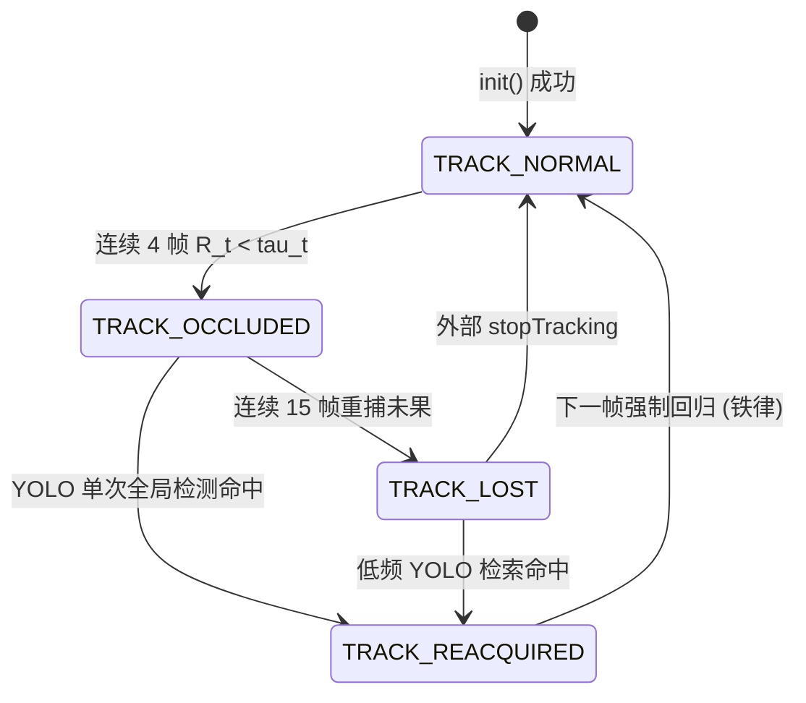

# Qt上位机嵌入LightTrack轻量单目标跟踪算法执行方案

> **文件性质**：工程实施方案与代码接线规范  
> **归属工程**：[RGB_PTZ_Integrated](file:///d:/PyProjects/RGB_PTZ_Integrated)  
> **基准输入**：[待执行方案/Qt上位机嵌入LightTrack跟踪算法任务书.md](file:///d:/PyProjects/RGB_PTZ_Integrated/待执行方案/Qt上位机嵌入LightTrack跟踪算法任务书.md)  
> **编制日期**：2026-11-13

---

## 零、先决条件：LightTrack 纯静态 ONNX 导出

### 0.1 权重归档

将官方预训练权重从外部路径复制至工程归档位置：

```
源路径：D:\PyProjects\SOT_Tracking_Baselines\checkpoints\lighttrack\LightTrackM.pth
目标路径：weights/sot/lighttrack_m.pth
```

### 0.2 ONNX 导出脚本 (`scripts/export_lighttrack_onnx.py`)

脚本基于 LightTrack 原版 PyTorch 模型代码，执行双分支解耦导出：

```python
"""
LightTrackM 纯静态双分支 ONNX 导出脚本
输入/输出张量规格严格遵循任务书第 1.3 节定义
"""
import torch
import sys
sys.path.insert(0, 'D:/PyProjects/SOT_Tracking_Baselines')
from lighttrack.models.models import LightTrackM_Backbone, LightTrackM_Head

def export():
    weights = torch.load('weights/sot/lighttrack_m.pth', map_location='cpu')

    # ═══ 模板分支 ═══
    backbone = LightTrackM_Backbone()
    backbone.load_state_dict(weights, strict=False)
    backbone.eval()

    z = torch.randn(1, 3, 127, 127)
    torch.onnx.export(
        backbone, z,
        'models/lighttrack_template.onnx',
        input_names=['template_img'],
        output_names=['template_feat'],
        opset_version=17,
        dynamic_axes=None  # 纯静态
    )

    # ═══ 搜索分支 ═══
    head = LightTrackM_Head()
    head.load_state_dict(weights, strict=False)
    head.eval()

    x = torch.randn(1, 3, 255, 255)
    feat = torch.randn(1, 96, 8, 8)
    torch.onnx.export(
        head, (x, feat),
        'models/lighttrack_search.onnx',
        input_names=['search_img', 'template_feat'],
        output_names=['cls_score', 'reg_dist'],
        opset_version=17,
        dynamic_axes=None
    )

if __name__ == '__main__':
    export()
```

### 0.3 导出结果校验

| 文件 | 张量名 | 形状 | 数据类型 |
| :--- | :--- | :--- | :--- |
| `models/lighttrack_template.onnx` | 输入 `template_img` | `[1, 3, 127, 127]` | float32 |
| | 输出 `template_feat` | `[1, 96, 8, 8]` | float32 |
| `models/lighttrack_search.onnx` | 输入 `search_img` | `[1, 3, 255, 255]` | float32 |
| | 输入 `template_feat` | `[1, 96, 8, 8]` | float32 |
| | 输出 `cls_score` | `[1, 1, 16, 16]` | float32 |
| | 输出 `reg_dist` | `[1, 4, 16, 16]` | float32 |

使用 `python -c "import onnxruntime as ort; s=ort.InferenceSession('models/lighttrack_template.onnx'); print([(i.name,i.shape) for i in s.get_inputs()+s.get_outputs()])"` 校验张量签名。与 Python 评测脚本 `eval_sot.py` 执行 20 组序列逐帧数值比对，确认 C++ 导出模型与 Python 原版精度一致（最大绝对误差 < 1e-5）。

---

## 一、任务 1：C++ 深度跟踪引擎 `OnnxSotTracker` 架构与接口设计

### 1.1 类声明 (`onnxsottracker.h`)

```cpp
#ifndef ONNXSOTTRACKER_H
#define ONNXSOTTRACKER_H

#include <opencv2/core.hpp>
#include <opencv2/imgproc.hpp>
#include <QString>
#include <vector>
#include <mutex>
#include <string>

// ONNX Runtime C-API 前置声明
struct OrtApi;
struct OrtEnv;
struct OrtSession;
struct OrtSessionOptions;
struct OrtMemoryInfo;

/**
 * @brief 深度单目标跟踪引擎结果
 */
struct SotKernelResult {
    cv::Rect bbox;            // 跟踪输出边界框 (x, y, w, h)
    float confidence;         // 归一化置信度 [0, 1] (cls_score 峰值，经 sigmoid)
    cv::Point2f center;       // 目标中心 (原图像素坐标)
    float scale;              // 当前尺度因子 s_x / s_z
};

/**
 * @brief 基于 ONNX Runtime C-API + DirectML 的深度单目标跟踪引擎
 *
 * 架构：
 *   模板分支 OrtSession：目标框选/重捕时单次运行，输出特征张量驻留内存
 *   搜索分支 OrtSession：逐帧高频推断，接收搜索图 + 模板特征，输出分类响应图 + 回归偏移
 *
 * 图像规范化：BGR → RGB，像素值 / 255.0 映射至 [0, 1]，无 ImageNet 均值/方差标准化
 * 越界填充值：通道均值 (avg_chans)
 */
class OnnxSotTracker
{
public:
    OnnxSotTracker();
    ~OnnxSotTracker();

    // 禁止拷贝（持有 ORT 裸指针资源）
    OnnxSotTracker(const OnnxSotTracker&) = delete;
    OnnxSotTracker& operator=(const OnnxSotTracker&) = delete;

    /**
     * @brief 加载双分支 ONNX 模型
     * @param templateModelPath  模板分支 ONNX 路径 (如 "models/lighttrack_template.onnx")
     * @param searchModelPath    搜索分支 ONNX 路径 (如 "models/lighttrack_search.onnx")
     * @param useGpu             是否启用 DirectML GPU 加速 (默认 true)
     * @param deviceId           GPU 设备索引 (默认 0)
     * @return 加载成功返回 true
     */
    bool loadModel(const QString& templateModelPath,
                   const QString& searchModelPath,
                   bool useGpu = true, int deviceId = 0);

    bool isLoaded() const;

    /**
     * @brief 初始化跟踪（提取模板特征）
     * @param image  当前帧 BGR cv::Mat
     * @param bbox   初始目标边界框 (x, y, w, h)
     * @return 初始化成功返回 true
     */
    bool init(const cv::Mat& image, const cv::Rect& bbox);

    /**
     * @brief 逐帧跟踪更新
     * @param image  当前帧 BGR cv::Mat
     * @return 跟踪结果（边界框、置信度、中心、尺度）
     */
    SotKernelResult track(const cv::Mat& image);

    bool isInitialized() const { return m_initialized; }
    float getInferenceTimeMs() const { return m_lastInferenceMs; }
    QString modelName() const { return QStringLiteral("LightTrack-DML"); }

private:
    // ═══ ONNX Runtime 资源 ═══
    const OrtApi* m_api = nullptr;
    OrtEnv* m_env = nullptr;

    // 模板分支 Session
    OrtSession* m_templateSession = nullptr;
    OrtSessionOptions* m_templateOptions = nullptr;

    // 搜索分支 Session
    OrtSession* m_searchSession = nullptr;
    OrtSessionOptions* m_searchOptions = nullptr;

    OrtMemoryInfo* m_memoryInfo = nullptr;

    // 节点名称缓存（_strdup 分配，需 free 释放）
    char* m_tmplInputName = nullptr;    // "template_img"
    char* m_tmplOutputName = nullptr;   // "template_feat"
    char* m_srchInputName1 = nullptr;   // "search_img"
    char* m_srchInputName2 = nullptr;   // "template_feat"
    char* m_srchOutputName1 = nullptr;  // "cls_score"
    char* m_srchOutputName2 = nullptr;  // "reg_dist"

    // 模板特征缓存（init 后驻留，跟踪期间不变）
    std::vector<float> m_templateFeat;  // 展平后 96*8*8 = 6144 floats
    int m_featC = 96, m_featH = 8, m_featW = 8;

    // 搜索分支输出维度
    int m_clsH = 16, m_clsW = 16;      // cls_score 空间尺寸
    int m_regChannels = 4;              // reg_dist 通道数 (l, t, r, b)

    // ═══ 跟踪状态 ═══
    bool m_loaded = false;
    bool m_initialized = false;
    bool m_usingGpu = false;
    float m_lastInferenceMs = 0.0f;

    // 目标状态（像素坐标）
    cv::Point2f m_targetCenter;         // 上一帧目标中心
    cv::Size2f m_targetSize;            // 当前目标尺寸 (w, h)

    // 上下文裁切参数
    float m_channelAvg[3] = {};         // 通道均值 (B, G, R)

    // 余弦窗 (16×16)
    cv::Mat m_cosWindow;                // float32, 归一化后

    // 超参数
    static constexpr int EXEMPLAR_SZ = 127;   // 模板输入尺寸
    static constexpr int INSTANCE_SZ = 255;   // 搜索输入尺寸
    static constexpr int RESPONSE_SZ = 16;    // 响应图空间尺寸
    static constexpr float WINDOW_INFLUENCE = 0.176f;  // 余弦窗惩罚权重
    static constexpr float SIZE_LR = 0.38f;   // 尺度平滑学习率

    // ═══ 预处理 ═══
    cv::Mat cropPatch(const cv::Mat& image, cv::Point2f center,
                      float cropSz, int outSz);
    void computeChannelAvg(const cv::Mat& image);
    void toNCHW(const cv::Mat& bgr, std::vector<float>& out);

    // ═══ 后处理 ═══
    void createCosineWindow();
    SotKernelResult decodeResponse(const float* clsData, const float* regData);

    // ═══ 资源释放 ═══
    void release();

    mutable std::mutex m_mutex;
};

#endif // ONNXSOTTRACKER_H
```

### 1.2 ONNX Session 生命周期管理

**初始化序列** (`loadModel()`)：

```
1. m_api = OrtGetApiBase()->GetApi(ORT_API_VERSION)
2. m_api->CreateEnv(ORT_LOGGING_LEVEL_WARNING, "OnnxSotTracker", &m_env)
3. 模板分支 Session：
   a. CreateSessionOptions(&m_templateOptions)
   b. SetIntraOpNumThreads(m_templateOptions, 1)      // 单线程（模板分支低频调用）
   c. SetSessionGraphOptimizationLevel(m_templateOptions, ORT_ENABLE_ALL)
   d. if (useGpu) OrtSessionOptionsAppendExecutionProvider_DML(m_templateOptions, deviceId)
   e. CreateSession(m_env, wTemplatePath, m_templateOptions, &m_templateSession)
   f. 查询输入/输出节点名称与形状，缓存至 m_tmplInputName / m_tmplOutputName
4. 搜索分支 Session：
   a. CreateSessionOptions(&m_searchOptions)
   b. SetIntraOpNumThreads(m_searchOptions, 1)
   c. SetSessionGraphOptimizationLevel(m_searchOptions, ORT_ENABLE_ALL)
   d. if (useGpu) OrtSessionOptionsAppendExecutionProvider_DML(m_searchOptions, deviceId)
   e. CreateSession(m_env, wSearchPath, m_searchOptions, &m_searchSession)
   f. 查询双输入/双输出节点名称与形状
5. CreateCpuMemoryInfo(OrtArenaAllocator, OrtMemTypeDefault, &m_memoryInfo)
6. 预分配 m_templateFeat 缓存
7. 创建余弦窗 createCosineWindow()
```

**释放序列** (`release()`, 析构函数调用)：

```
1. free(m_tmplInputName) / free(m_tmplOutputName) / ... (6 个节点名)
2. m_api->ReleaseSession(m_searchSession)
3. m_api->ReleaseSessionOptions(m_searchOptions)
4. m_api->ReleaseSession(m_templateSession)
5. m_api->ReleaseSessionOptions(m_templateOptions)
6. m_api->ReleaseMemoryInfo(m_memoryInfo)
7. m_api->ReleaseEnv(m_env)
8. 全部指针置 nullptr
```

**DirectML MinGW 兼容性**：在 `onnxsottracker.cpp` 顶部，包含 `dml_provider_factory.h` 前定义 SAL 空宏（复用 [onnxdetector.cpp](file:///d:/PyProjects/RGB_PTZ_Integrated/onnxdetector.cpp) 已验证的兼容方案）：

```cpp
#ifndef _Maybenull_
#define _Maybenull_
#endif
#ifndef _Maybenull_string_
#define _Maybenull_string_
#endif
#include <dml_provider_factory.h>
```

### 1.3 图像前处理数学定义

#### 1.3.1 上下文扩展与裁切尺寸

给定目标框 $(x, y, w, h)$，中心 $c = (c_x, c_y)$：

**上下文填充量**：

$$p = \frac{w + h}{2}$$

**模板上下文边长**（原图像素）：

$$s_z = \sqrt{(w + 2p)(h + 2p)}$$

**搜索上下文边长**（原图像素）：

$$s_x = s_z \cdot \frac{\text{INSTANCE\_SZ}}{\text{EXEMPLAR\_SZ}} = s_z \cdot \frac{255}{127} \approx 2.0079 \cdot s_z$$

#### 1.3.2 子窗口裁切 (`cropPatch`)

从原图以 $c$ 为中心裁取 $\text{cropSz} \times \text{cropSz}$ 区域，缩放至 $\text{outSz} \times \text{outSz}$：

```
1. 计算裁切坐标：
   x1 = round(cx - cropSz / 2)
   y1 = round(cy - cropSz / 2)
   x2 = x1 + round(cropSz)
   y2 = y1 + round(cropSz)

2. 越界填充（通道均值 avg_chans）：
   padLeft   = max(0, -x1)
   padTop    = max(0, -y1)
   padRight  = max(0, x2 - image.cols)
   padBottom = max(0, y2 - image.rows)

   x1c = max(0, x1),  y1c = max(0, y1)
   x2c = min(image.cols, x2),  y2c = min(image.rows, y2)

   crop = image(Rect(x1c, y1c, x2c-x1c, y2c-y1c))
   if 任何 pad > 0:
       cv::copyMakeBorder(crop, crop, padTop, padBottom, padLeft, padRight,
                          BORDER_CONSTANT, Scalar(avg_chans[0], avg_chans[1], avg_chans[2]))

3. 双线性缩放：
   cv::resize(crop, output, Size(outSz, outSz), 0, 0, INTER_LINEAR)
```

#### 1.3.3 数值归一化与张量排布 (`toNCHW`)

```
1. BGR → RGB：cv::cvtColor(patch, rgb, COLOR_BGR2RGB)
2. 像素归一化：rgb.convertTo(rgbFloat, CV_32F, 1.0 / 255.0)
3. HWC → NCHW（平面排布）：
   float* ptrR = out.data();
   float* ptrG = ptrR + H * W;
   float* ptrB = ptrG + H * W;
   逐像素填充三通道平面
```

### 1.4 响应图后处理与边界框解码 (`decodeResponse`)

#### 1.4.1 网格坐标生成

响应图尺寸 $R = 16$，步幅（原图像素单位）：

$$\text{stride} = \frac{s_x}{R}$$

网格中心偏移量（以搜索中心为原点，原图像素单位）：

$$g_i = i \cdot \text{stride} + \frac{\text{stride}}{2} - \frac{s_x}{2}, \quad i = 0, 1, \ldots, R-1$$

使用二维网格 $G_x[r][c] = g_c, \quad G_y[r][c] = g_r$。

#### 1.4.2 余弦窗位移惩罚

$16 \times 16$ 二维汉宁窗：

$$W[r][c] = \text{hann}(r) \cdot \text{hann}(c), \quad \text{hann}(k) = 0.5\left(1 - \cos\frac{2\pi k}{R - 1}\right)$$

归一化：$W \leftarrow W / \sum W$。

惩罚后得分：

$$S_{\text{pen}}[r][c] = (1 - \lambda_w) \cdot \sigma(\text{cls}[0,0,r,c]) + \lambda_w \cdot W[r][c]$$

其中 $\sigma$ 为 sigmoid 函数，$\lambda_w = 0.176$。

#### 1.4.3 峰值搜索与回归解码

1. 在 $S_{\text{pen}}$ 上搜索全局最大值位置 $(b_r, b_c)$，记峰值 $S_{\text{peak}}$。
2. 提取回归量（原图像素单位）：

$$l = \text{reg}[0, 0, b_r, b_c] \cdot \text{stride}$$
$$t = \text{reg}[0, 1, b_r, b_c] \cdot \text{stride}$$
$$r = \text{reg}[0, 2, b_r, b_c] \cdot \text{stride}$$
$$b = \text{reg}[0, 3, b_r, b_c] \cdot \text{stride}$$

3. 计算预测框中心位移与尺寸（原图像素）：

$$\Delta c_x = G_x[b_r][b_c] + \frac{r - l}{2}$$

$$\Delta c_y = G_y[b_r][b_c] + \frac{b - t}{2}$$

$$w_{\text{pred}} = l + r$$

$$h_{\text{pred}} = t + b$$

4. 映射至原图坐标：

$$c_x^{\text{new}} = c_x^{\text{prev}} + \Delta c_x$$

$$c_y^{\text{new}} = c_y^{\text{prev}} + \Delta c_y$$

### 1.5 尺度平滑更新

预测尺寸通过指数移动平均平滑更新，防止抖动：

$$w_{\text{new}} = (1 - \text{lr}_s \cdot S_{\text{peak}}) \cdot w_{\text{prev}} + \text{lr}_s \cdot S_{\text{peak}} \cdot w_{\text{pred}}$$

$$h_{\text{new}} = (1 - \text{lr}_s \cdot S_{\text{peak}}) \cdot h_{\text{prev}} + \text{lr}_s \cdot S_{\text{peak}} \cdot h_{\text{pred}}$$

$\text{lr}_s = 0.38$，$S_{\text{peak}}$ 为归一化后的峰值置信度。高置信度时更积极地采纳预测尺寸，低置信度时保持上一帧尺寸。

### 1.6 `init()` 完整流程

```
1. 保存目标中心 m_targetCenter = (bbox.x + bbox.width/2, bbox.y + bbox.height/2)
2. 保存目标尺寸 m_targetSize = (bbox.width, bbox.height)
3. 计算通道均值 computeChannelAvg(image)
4. 计算模板裁切尺寸 s_z = sqrt((w+2p)(h+2p))
5. 裁取模板补丁 tmplPatch = cropPatch(image, center, s_z, 127)
6. HWC→NCHW 归一化 toNCHW(tmplPatch, tmplInput)
7. 构建 OrtValue 输入张量 shape=[1,3,127,127]
8. Run 模板分支 Session → 输出 OrtValue
9. 从输出 OrtValue 拷贝数据至 m_templateFeat
10. 释放输入/输出 OrtValue
11. m_initialized = true
```

### 1.7 `track()` 完整流程

```
1. 计算搜索裁切尺寸 s_x = s_z * (255/127)
2. 裁取搜索补丁 srchPatch = cropPatch(image, m_targetCenter, s_x, 255)
3. HWC→NCHW 归一化 toNCHW(srchPatch, srchInput)
4. 构建两个 OrtValue 输入张量：
   - search_img: shape=[1,3,255,255], data=srchInput
   - template_feat: shape=[1,96,8,8], data=m_templateFeat
5. Run 搜索分支 Session → 两个输出 OrtValue (cls_score, reg_dist)
6. 提取输出数据指针 clsData, regData
7. decodeResponse(clsData, regData) → 解码得 SotKernelResult
8. 更新目标状态：m_targetCenter, m_targetSize
9. 更新 s_z（基于新目标尺寸重算上下文边长）
10. 释放输入/输出 OrtValue
11. 记录推理耗时
```

### 1.8 异常捕获与内存安全

| 防护项 | 机制 |
| :--- | :--- |
| ORT API 调用失败 | 每次 `OrtStatus*` 返回值检查，失败时提取错误消息、释放 Status、打印 `qWarning` 并返回 `false` |
| 多线程安全 | `std::lock_guard<std::mutex>` 保护 `loadModel`、`init`、`track` 全部公开方法 |
| 内存泄漏防护 | OrtValue 采用 RAII 局部变量，在 scope 结束前 `ReleaseValue`；节点名 `_strdup` 分配，`release()` 中 `free` |
| 图像越界 | `cropPatch` 内 `copyMakeBorder` 处理越界填充，`cv::Rect & imgBounds` 裁剪保护 |
| NaN/Inf | `decodeResponse` 中对回归量和坐标做 `std::isnan/isinf` 校验，异常时退回上一帧位置 |

---

## 二、任务 2：跟踪器抽象与双引擎热切换机制设计

### 2.1 跟踪内核枚举

在 [objecttracker.h](file:///d:/PyProjects/RGB_PTZ_Integrated/objecttracker.h) 中新增：

```cpp
enum class TrackingKernel {
    KERNEL_DSST = 0,        // 传统相关滤波 (DsstCore)
    KERNEL_LIGHTTRACK = 1   // 深度神经网络 (OnnxSotTracker + DirectML)
};
```

### 2.2 ObjectTracker 双内核集成方案

采用**并列持有 + 条件分派**架构。保留 `DsstCore m_core` 成员不变（保证 Mode A 纯 SOT 模式零改动），新增 `std::unique_ptr<OnnxSotTracker> m_sotTracker` 成员。内核选择通过 `m_kernelType` 在 `init()` 与 `update()` 中分派。

#### 2.2.1 新增成员变量

```cpp
// objecttracker.h 新增 private 成员
#include "onnxsottracker.h"

TrackingKernel m_kernelType = TrackingKernel::KERNEL_DSST;
std::unique_ptr<OnnxSotTracker> m_sotTracker;
```

#### 2.2.2 新增公开接口

```cpp
// objecttracker.h 新增 public 方法
void setTrackingKernel(TrackingKernel kernel);
TrackingKernel trackingKernel() const { return m_kernelType; }
bool loadSotModel(const QString& templatePath, const QString& searchPath,
                  bool useGpu = true);
```

#### 2.2.3 内核分派辅助方法

在 [objecttracker.cpp](file:///d:/PyProjects/RGB_PTZ_Integrated/objecttracker.cpp) 中抽取两个内部分派辅助函数，供 `init()` 和 `update()` 的 Mode B (AMFT 协同模式) 调用：

```cpp
// objecttracker.cpp 新增 private 方法

struct KernelOutput {
    cv::Rect bbox;
    float confidence;    // [0, 1] 归一化置信度
    cv::Point2f center;
    float scale;
    bool valid;
};

KernelOutput ObjectTracker::runKernel(const cv::Mat& image)
{
    KernelOutput out{};
    if (m_kernelType == TrackingKernel::KERNEL_LIGHTTRACK && m_sotTracker && m_sotTracker->isInitialized()) {
        SotKernelResult r = m_sotTracker->track(image);
        out.bbox = r.bbox;
        out.confidence = r.confidence;  // cls_score 峰值，已 [0,1]
        out.center = r.center;
        out.scale = r.scale;
        out.valid = (r.bbox.width > 0 && r.bbox.height > 0);
    } else {
        // DSST 路径（原有逻辑）
        cv::Mat response;
        out.bbox = m_core.update(image, &response);
        out.valid = (out.bbox.width > 0 && out.bbox.height > 0);
        float psr = out.valid ? computePSR(response) : 0.0f;
        // PSR → [0,1] 归一化（与 AMFTEvaluator::computeSConf 对齐：PSR 5~25 线性映射）
        out.confidence = std::clamp((psr - 5.0f) / 20.0f, 0.0f, 1.0f);
        out.center = m_core.position();
        out.scale = m_core.currentScale();
    }
    return out;
}

bool ObjectTracker::reinitKernel(const cv::Mat& image, const cv::Rect& bbox)
{
    if (m_kernelType == TrackingKernel::KERNEL_LIGHTTRACK && m_sotTracker) {
        return m_sotTracker->init(image, bbox);
    } else {
        return m_core.init(image, bbox);
    }
}
```

#### 2.2.4 `update()` Mode B 改造点

在 [objecttracker.cpp](file:///d:/PyProjects/RGB_PTZ_Integrated/objecttracker.cpp) 第 686-701 行（正常局部跟踪主循环），将：

```cpp
cv::Mat response;
const cv::Rect bbox = m_core.update(image, &response);
const bool detValid = (bbox.width > 0 && bbox.height > 0);
const float psr = detValid ? computePSR(response) : 0.0f;
```

替换为：

```cpp
auto ko = runKernel(image);
const bool detValid = ko.valid;
const float psr = ko.confidence * 25.0f;  // 反映射回 PSR 量级供 AMFT 使用
```

类似地，`init()` 中第 103 行 `m_core.init(image, roi)` 替换为 `reinitKernel(image, roi)`。

`tryDetectAndRecover()` 中第 365 行 `m_core.init(image, newRoi)` 替换为 `reinitKernel(image, newRoi)`。

Mode A（纯 SOT 模式，`m_redetectionEnabled == false`）代码路径保持原样不变，继续直接调用 `m_core`。

### 2.3 生命周期管理与热切换流程

`setTrackingKernel()` 执行安全切换：

```cpp
void ObjectTracker::setTrackingKernel(TrackingKernel kernel)
{
    if (kernel == m_kernelType) return;

    // 1. 停止当前跟踪状态
    m_initialized = false;
    m_trackingState = AMFTTrackingState::TRACK_NORMAL;
    m_lostCount = 0;
    m_evaluator.reset();

    // 2. 切换内核类型
    m_kernelType = kernel;

    // 3. 按需懒加载深度模型
    if (kernel == TrackingKernel::KERNEL_LIGHTTRACK && !m_sotTracker) {
        m_sotTracker = std::make_unique<OnnxSotTracker>();
        // 模型加载由外部 loadSotModel() 驱动
    }

    qCDebug(trackerLog) << "[Tracker] 跟踪内核切换至"
                        << (kernel == TrackingKernel::KERNEL_LIGHTTRACK ? "LightTrack" : "DSST");
}
```

**切换时序约束**：
- 切换操作在 ObjectTracker 的 worker 线程中执行（通过 `QMetaObject::invokeMethod` 异步投递）
- 切换后必须重新调用 `initSlot()` 才能恢复跟踪
- 切换过程中不持有任何 ORT 资源锁（避免死锁）

### 2.4 TrackingController 层适配

在 [trackingcontroller.h](file:///d:/PyProjects/RGB_PTZ_Integrated/trackingcontroller.h) / [trackingcontroller.cpp](file:///d:/PyProjects/RGB_PTZ_Integrated/trackingcontroller.cpp) 中：

```cpp
// trackingcontroller.h 新增
void setTrackingKernel(TrackingKernel kernel);
TrackingKernel trackingKernel() const { return m_kernelType; }

// trackingcontroller.h 新增 private
TrackingKernel m_kernelType = TrackingKernel::KERNEL_DSST;
```

`setTrackingKernel()` 实现：

```cpp
void TrackingController::setTrackingKernel(TrackingKernel kernel)
{
    m_kernelType = kernel;
    if (m_tracker) {
        QMetaObject::invokeMethod(m_tracker, [this, kernel]() {
            m_tracker->setTrackingKernel(kernel);
        }, Qt::QueuedConnection);
    }
}
```

在 `setTarget()` 创建 ObjectTracker 后，注入内核类型：

```cpp
m_tracker->setTrackingKernel(m_kernelType);
if (m_kernelType == TrackingKernel::KERNEL_LIGHTTRACK) {
    m_tracker->loadSotModel("models/lighttrack_template.onnx",
                            "models/lighttrack_search.onnx", true);
}
```

### 2.5 MainWindow UI 配置

在 [mainwindow.ui](file:///d:/PyProjects/RGB_PTZ_Integrated/mainwindow.ui) 界面中增加跟踪内核选择 ComboBox（`comboTrackKernel`），位置放置在现有控制面板区域：

```
comboTrackKernel 下拉选项：
  - "DSST (传统相关滤波)"       → TrackingKernel::KERNEL_DSST
  - "LightTrack (深度神经网络)"  → TrackingKernel::KERNEL_LIGHTTRACK
```

信号连接：

```cpp
connect(ui->comboTrackKernel, QOverload<int>::of(&QComboBox::currentIndexChanged),
        this, [this](int index) {
    auto kernel = static_cast<TrackingKernel>(index);
    m_trackingController->setTrackingKernel(kernel);
    ui->statusBar->showMessage(
        kernel == TrackingKernel::KERNEL_LIGHTTRACK
            ? "跟踪内核: LightTrack (DirectML GPU)"
            : "跟踪内核: DSST (传统相关滤波)", 3000);
});
```

`refreshModelList()` 中的 `sot_` 前缀过滤规则保持不变（SOT 模型由内核选择器控制，与 YOLO 检测模型下拉框独立）。

---

## 三、任务 3：深度跟踪置信度与 AMFT 协同状态机接线设计

### 3.1 置信度归一化协议

[AMFTEvaluator::evaluate()](file:///d:/PyProjects/RGB_PTZ_Integrated/amftevaluator.cpp#L184) 第一参数 `float psr` 的 `computeSConf()` 内部执行 PSR 线性归一化：

```cpp
// amftevaluator.cpp:62-63 现有逻辑
return std::clamp((psr - 5.0f) / 20.0f, 0.0f, 1.0f);
```

PSR 值域 $[5, 25]$ → $[0, 1]$。

**对接方案**：在 `runKernel()` 中，DSST 路径直接返回原始 PSR 值传入 `evaluate()`；LightTrack 路径将 cls_score 峰值（已在 $[0, 1]$）反映射为等效 PSR 值：

$$\text{psr}_{\text{equiv}} = \text{confidence} \times 20.0 + 5.0$$

这使 `computeSConf()` 无需修改即可正确归一化两种输入源。

**在 `update()` Mode B 中的实际调用**：

```cpp
auto ko = runKernel(image);
// ...
float psrForAmft;
if (m_kernelType == TrackingKernel::KERNEL_LIGHTTRACK) {
    psrForAmft = ko.confidence * 20.0f + 5.0f;  // [0,1] → [5,25]
} else {
    psrForAmft = ko.valid ? computePSR(response) : 0.0f;  // 原始 PSR
}
m_lastScore = m_evaluator.evaluate(psrForAmft, ko.valid, evalBox, image);
```

AMFTEvaluator 的 $S_{\text{mot}}$ (运动连续性) 和 $S_{\text{bg}}$ (背景可区分度) 维度完全基于目标框几何与图像内容计算，与跟踪内核无关，无需改动。

### 3.2 状态机流转时序（与现有 AMFT 四态完全一致）



LightTrack 内核接入后，状态流转逻辑与现有 [objecttracker.cpp](file:///d:/PyProjects/RGB_PTZ_Integrated/objecttracker.cpp#L633-L767) 第 633-767 行 Mode B 代码路径完全复用，改动点仅在内核调用处。

### 3.3 YOLO 重捕触发与 LightTrack 模板更新时序

YOLO 重捕触发条件不变：`tryDetectAndRecover()` 调用 `m_detector->detect(image)` 全图扫描。

重捕成功后模板更新流程：

```
1. YOLO 检出最佳候选框 newRoi
2. 调用 reinitKernel(image, newRoi)
   → LightTrack 路径：m_sotTracker->init(image, newRoi)
     → 重新裁取模板补丁 → 运行模板分支 ONNX → 覆写 m_templateFeat
   → DSST 路径：m_core.init(image, newRoi)（原有逻辑）
3. 更新 m_posX, m_posY, m_targetW, m_targetH, m_currentScale
4. KF 更新 kfUpdate(m_posX, m_posY)
5. AMFT 评估器重初始化 m_evaluator.init(newBox)
6. 状态机转入 TRACK_REACQUIRED
7. 下一帧铁律强制回归 TRACK_NORMAL
```

### 3.4 变焦尺度纠偏联动

现有 `triggerScaleCalibration()` 标记 `m_needScaleCalibration = true`，在下一帧 Mode B 正常跟踪分支中触发 `tryDetectAndRecover(image)` 完成尺度重校准。

LightTrack 内核接入后，此流程通过 `reinitKernel()` 分派，无需额外改动。重校准完成后，`s_z` 基于新目标尺寸重新计算，搜索区域自适应调整。

---

## 四、任务 4：离线评测工具 `tools/test_sot_tracker.cpp`

### 4.1 工具架构

参照 [tools/test_amft.cpp](file:///d:/PyProjects/RGB_PTZ_Integrated/tools/test_amft.cpp) 的 Qt Console Application 架构，设计专用的深度 SOT 离线批处理评测工具。

```cpp
// tools/test_sot_tracker.cpp 主体结构

#include <QCoreApplication>
#include <QElapsedTimer>
#include <opencv2/core.hpp>
#include <opencv2/imgproc.hpp>
#include <opencv2/imgcodecs.hpp>
#include <iostream>
#include <fstream>
#include <filesystem>
#include <cmath>
#include <vector>
#include <algorithm>
#include <numeric>

#include "../onnxsottracker.h"

namespace fs = std::filesystem;

// ═══ Ground Truth 加载 ═══
struct GTBox { int x, y, w, h; bool valid; };
std::vector<GTBox> loadGroundTruth(const std::string& path);

// ═══ 指标计算 ═══
double computeIoU(const cv::Rect& a, const cv::Rect& b);
double computeSuccessAUC(const std::vector<double>& ious);
double computeDP(const std::vector<double>& distances, double threshold);

int main(int argc, char* argv[])
{
    QCoreApplication app(argc, argv);

    // 模型路径（支持命令行参数覆盖）
    std::string tmplModel = "models/lighttrack_template.onnx";
    std::string srchModel = "models/lighttrack_search.onnx";
    if (argc > 1) tmplModel = argv[1];
    if (argc > 2) srchModel = argv[2];

    std::string datasetDir = "datasets/Anti-UAV/tracking/Anti-UAV-Tracking-V0";
    std::string gtDir      = "datasets/Anti-UAV/tracking/Anti-UAV-Tracking-V0GT";

    // 加载深度 SOT 引擎
    OnnxSotTracker tracker;
    if (!tracker.loadModel(QString::fromStdString(tmplModel),
                           QString::fromStdString(srchModel), true)) {
        std::cerr << "模型加载失败" << std::endl;
        return 1;
    }

    // ═══ 全局统计量 ═══
    std::vector<double> allIoUs, allDistances;
    int totalFrames = 0, lostFrames = 0;
    double totalModelMs = 0.0, totalE2EMs = 0.0;
    size_t peakMemoryKB = 0;

    // ═══ 遍历 20 组序列 ═══
    for (int vid = 1; vid <= 20; ++vid) {
        std::string vname = "video" + std::string(vid < 10 ? "0" : "") + std::to_string(vid);
        std::string vdir = datasetDir + "/" + vname;
        std::string gtFile = gtDir + "/" + vname + "_gt.txt";
        auto gtBoxes = loadGroundTruth(gtFile);

        // 加载帧路径并排序
        std::vector<std::string> frames;
        for (auto& e : fs::directory_iterator(vdir))
            if (e.path().extension() == ".jpg" || e.path().extension() == ".png")
                frames.push_back(e.path().string());
        std::sort(frames.begin(), frames.end());

        bool initialized = false;
        std::vector<double> seqIoUs, seqDists;
        double seqModelMs = 0.0;

        for (size_t i = 0; i < frames.size() && i < gtBoxes.size(); ++i) {
            cv::Mat frame = cv::imread(frames[i]);
            if (frame.empty()) continue;

            QElapsedTimer e2eTimer;
            e2eTimer.start();

            if (!initialized && gtBoxes[i].valid) {
                cv::Rect initRect(gtBoxes[i].x, gtBoxes[i].y, gtBoxes[i].w, gtBoxes[i].h);
                tracker.init(frame, initRect);
                initialized = true;
                continue;
            }
            if (!initialized) continue;

            SotKernelResult result = tracker.track(frame);
            seqModelMs += tracker.getInferenceTimeMs();
            totalE2EMs += e2eTimer.elapsed();
            totalFrames++;

            // 计算指标
            if (gtBoxes[i].valid) {
                cv::Rect gt(gtBoxes[i].x, gtBoxes[i].y, gtBoxes[i].w, gtBoxes[i].h);
                double iou = computeIoU(result.bbox, gt);
                seqIoUs.push_back(iou);
                allIoUs.push_back(iou);

                double cx_p = result.bbox.x + result.bbox.width / 2.0;
                double cy_p = result.bbox.y + result.bbox.height / 2.0;
                double cx_g = gt.x + gt.width / 2.0;
                double cy_g = gt.y + gt.height / 2.0;
                double cle = std::sqrt(std::pow(cx_p - cx_g, 2) + std::pow(cy_p - cy_g, 2));
                seqDists.push_back(cle);
                allDistances.push_back(cle);

                if (iou == 0.0) lostFrames++;
            }
        }

        // 单序列输出
        double seqAUC = computeSuccessAUC(seqIoUs);
        double seqDP20 = computeDP(seqDists, 20.0);
        double seqCLE = seqDists.empty() ? 0.0 :
            std::accumulate(seqDists.begin(), seqDists.end(), 0.0) / seqDists.size();
        int seqN = static_cast<int>(seqIoUs.size());
        double seqFPS = seqN > 0 ? 1000.0 * seqN / seqModelMs : 0.0;

        std::cout << "[" << vname << "] " << seqN << " frames"
                  << " | AUC=" << (seqAUC * 100.0) << "%"
                  << " | DP@20=" << (seqDP20 * 100.0) << "%"
                  << " | CLE=" << seqCLE << "px"
                  << " | FPS=" << seqFPS << std::endl;

        totalModelMs += seqModelMs;
    }

    // ═══ 全局汇总 ═══
    double auc = computeSuccessAUC(allIoUs);
    double dp20 = computeDP(allDistances, 20.0);
    double meanCLE = allDistances.empty() ? 0.0 :
        std::accumulate(allDistances.begin(), allDistances.end(), 0.0) / allDistances.size();
    double avgModelMs = totalFrames > 0 ? totalModelMs / totalFrames : 0.0;
    double modelFPS = avgModelMs > 0 ? 1000.0 / avgModelMs : 0.0;
    double e2eFPS = totalFrames > 0 ? 1000.0 * totalFrames / totalE2EMs : 0.0;
    double lostRate = totalFrames > 0 ? 100.0 * lostFrames / totalFrames : 0.0;

    std::cout << "\n═══ C++ OnnxSotTracker 综合评测 ═══" << std::endl;
    std::cout << "总帧数:       " << totalFrames << std::endl;
    std::cout << "成功率 AUC:   " << (auc * 100.0) << "%" << std::endl;
    std::cout << "距离精度 DP@20: " << (dp20 * 100.0) << "%" << std::endl;
    std::cout << "平均 CLE:     " << meanCLE << " px" << std::endl;
    std::cout << "跟丢率:       " << lostRate << "%" << std::endl;
    std::cout << "纯模型推理:   " << avgModelMs << " ms/frame" << std::endl;
    std::cout << "模型 FPS:     " << modelFPS << std::endl;
    std::cout << "端到端 FPS:   " << e2eFPS << std::endl;

    return 0;
}
```

### 4.2 评测指标定义

| 指标 | 公式 | Python 基准 |
| :--- | :--- | :---: |
| **Success AUC** | $\text{AUC} = \frac{1}{101}\sum_{k=0}^{100} \frac{|\{i : \text{IoU}_i \ge k/100\}|}{N}$ | 52.24% |
| **DP@20** | $\frac{|\{i : \text{CLE}_i \le 20\}|}{N}$ | 66.06% |
| **Mean CLE** | $\frac{1}{N}\sum_{i=1}^N \sqrt{(\Delta c_x^i)^2 + (\Delta c_y^i)^2}$ | — |
| **Lost Rate** | $\frac{|\{i : \text{IoU}_i = 0\}|}{N} \times 100\%$ | 14.16% |
| **Model FPS** | $\frac{1000}{\bar{t}_{\text{model}}}$（纯 ONNX 推理耗时） | ≥ 400 FPS |
| **E2E FPS** | $\frac{1000 \times N}{\sum t_{\text{e2e}}}$（含 I/O + 前后处理） | ≥ 60 FPS |

### 4.3 验收通过标准

C++ 实现必须与 Python `eval_sot.py` 基准对齐：

| 指标 | 对齐容差 |
| :--- | :--- |
| AUC | 绝对差 ≤ 0.5% |
| DP@20 | 绝对差 ≤ 0.5% |
| CLE | 绝对差 ≤ 0.5 px |
| 纯模型推理 | ≤ 2.5 ms（DirectML 加速下） |

---

## 五、任务 5：工程文件变动清单与构建配置

### 5.1 新增文件

| 文件 | 用途 |
| :--- | :--- |
| `onnxsottracker.h` | 深度 SOT 跟踪引擎头文件 |
| `onnxsottracker.cpp` | 深度 SOT 跟踪引擎实现 |
| `tools/test_sot_tracker.cpp` | 离线批处理评测工具 |
| `scripts/export_lighttrack_onnx.py` | LightTrack ONNX 导出脚本 |
| `models/lighttrack_template.onnx` | LightTrack 模板分支 ONNX (导出产物) |
| `models/lighttrack_search.onnx` | LightTrack 搜索分支 ONNX (导出产物) |
| `weights/sot/lighttrack_m.pth` | LightTrack 官方预训练权重 (归档) |

### 5.2 修改文件

| 文件 | 改动内容 |
| :--- | :--- |
| [objecttracker.h](file:///d:/PyProjects/RGB_PTZ_Integrated/objecttracker.h) | 新增 `TrackingKernel` 枚举、`m_kernelType`、`m_sotTracker` 成员、`setTrackingKernel()`/`loadSotModel()` 方法、`KernelOutput` 结构体 |
| [objecttracker.cpp](file:///d:/PyProjects/RGB_PTZ_Integrated/objecttracker.cpp) | 新增 `runKernel()`/`reinitKernel()` 分派方法；Mode B 正常跟踪主循环 (L686-701) 改用 `runKernel()`；`init()` (L103) 和 `tryDetectAndRecover()` (L365) 改用 `reinitKernel()`；Mode A 代码路径不变 |
| [trackingcontroller.h](file:///d:/PyProjects/RGB_PTZ_Integrated/trackingcontroller.h) | 新增 `setTrackingKernel()`/`trackingKernel()` 方法、`m_kernelType` 成员 |
| [trackingcontroller.cpp](file:///d:/PyProjects/RGB_PTZ_Integrated/trackingcontroller.cpp) | `setTarget()` 中注入内核类型与 SOT 模型路径 |
| [mainwindow.h](file:///d:/PyProjects/RGB_PTZ_Integrated/mainwindow.h) | 新增 `comboTrackKernel` UI 控件指针 |
| [mainwindow.cpp](file:///d:/PyProjects/RGB_PTZ_Integrated/mainwindow.cpp) | 初始化 `comboTrackKernel`、绑定信号槽 |
| [mainwindow.ui](file:///d:/PyProjects/RGB_PTZ_Integrated/mainwindow.ui) | 增加跟踪内核选择 ComboBox 控件 |
| [RGB_PTZ_Integrated.pro](file:///d:/PyProjects/RGB_PTZ_Integrated/RGB_PTZ_Integrated.pro) | SOURCES/HEADERS 中新增 `onnxsottracker.h/.cpp` |

### 5.3 构建配置变更 (`RGB_PTZ_Integrated.pro`)

```pro
# 新增源文件
SOURCES += onnxsottracker.cpp
HEADERS += onnxsottracker.h
```

无需新增库依赖或宏定义。`OnnxSotTracker` 复用现有 ONNX Runtime + DirectML 链接配置（`-lonnxruntime -lDirectML`）与 OpenCV 配置（`-lopencv_core4100 -lopencv_imgproc4100`）。

### 5.4 模型部署目录

```
models/
├── lighttrack_template.onnx   (新增, ~3 MB)
├── lighttrack_search.onnx     (新增, ~5 MB)
├── sot_template.onnx          (既有, 自研 SOT 模型)
├── sot_search.onnx            (既有, 自研 SOT 模型)
├── yolo11n_uav_ft.onnx        (既有)
├── ...                        (其余 YOLO 模型)
```

`.pro` 文件中已有 `models/*.onnx` 自动复制至构建输出目录的 post-build 规则，新增 ONNX 文件无需额外配置。

---

## 六、任务 6：实施阶段划分与客观验收指标矩阵

### 6.1 实施阶段


| 阶段 | 内容 | 产出物 | 预估工时 |
| :---: | :--- | :--- | :---: |
| **P0** | Python ONNX 导出 + 数值对齐校验 | `lighttrack_template.onnx`, `lighttrack_search.onnx`, 对齐报告 | 0.5 天 |
| **P1** | `OnnxSotTracker` 类编写：ONNX Session 管理、前处理 (cropPatch + toNCHW)、后处理 (decodeResponse + 余弦窗)、init/track 主循环 | `onnxsottracker.h/.cpp` 编译通过 | 1.5 天 |
| **P2** | `test_sot_tracker.cpp` 编写，20 组序列全量跑通，指标与 Python 基准对齐 | 评测报告 (AUC/DP@20/CLE/FPS) | 1 天 |
| **P3** | ObjectTracker 双内核集成 (`TrackingKernel` 枚举 + `runKernel`/`reinitKernel`)、TrackingController 适配、MainWindow UI 控件、AMFT 置信度对接 | Release 构建 0 错误 0 警告 | 1 天 |
| **P4** | 整机联调：UI 框选目标 → LightTrack 实时跟踪 → AMFT 状态机 → YOLO 重捕 → PID/KF 伺服闭环；长时间稳定性验证 | 联调通过报告 | 0.5 天 |

### 6.2 客观验收指标矩阵

| 维度 | 指标 | 通过标准 | 验证方法 |
| :--- | :--- | :--- | :--- |
| **编译** | 构建结果 | Release 模式 0 错误 0 警告 (MinGW 13.1 64-bit) | `qmake && mingw32-make release` |
| **ONNX 对齐** | 模板分支输出 | 与 Python `torch` 推理结果最大绝对误差 < 1e-5 | 逐元素数值比对脚本 |
| **ONNX 对齐** | 搜索分支输出 | cls_score / reg_dist 与 Python 结果最大绝对误差 < 1e-4 | 逐元素数值比对脚本 |
| **精度 (AUC)** | 成功率 | ≥ 51.74% (Python 基准 52.24% - 0.5%) | `test_sot_tracker.exe` 20 组序列 |
| **精度 (DP@20)** | 距离精度 | ≥ 65.56% (Python 基准 66.06% - 0.5%) | `test_sot_tracker.exe` 20 组序列 |
| **精度 (CLE)** | 中心误差 | 与 Python 基准绝对差 ≤ 0.5 px | `test_sot_tracker.exe` 20 组序列 |
| **性能** | 纯模型推理 | ≤ 2.5 ms / frame (DirectML GPU) | `test_sot_tracker.exe` 平均值 |
| **性能** | 端到端帧率 | ≥ 60 FPS (含前后处理 + KF + PID) | 上位机整机运行实测 |
| **性能** | 模板分支推理 | ≤ 3 ms (单次初始化) | `test_sot_tracker.exe` 计时 |
| **稳定性** | 内存泄漏 | 连续运行 1000 帧后 Working Set 增量 < 5 MB | `test_sot_tracker.exe` 监测 |
| **稳定性** | GPU 显存 | 运行期间 GPU 显存占用稳定（无单调递增） | `nvidia-smi` 监测 |
| **功能** | 双内核切换 | UI 切换 DSST ↔ LightTrack 后重新框选目标可正常跟踪 | 手动操作验证 |
| **功能** | AMFT 协同 | LightTrack 内核下，遮挡 → YOLO 重捕 → 模板更新 → 恢复跟踪 | 人工遮挡测试 |
| **功能** | 飞行记录器 | LightTrack 内核下黑匣子 CSV 正常记录跟踪数据 | 检查 `日志/track_*.csv` |
