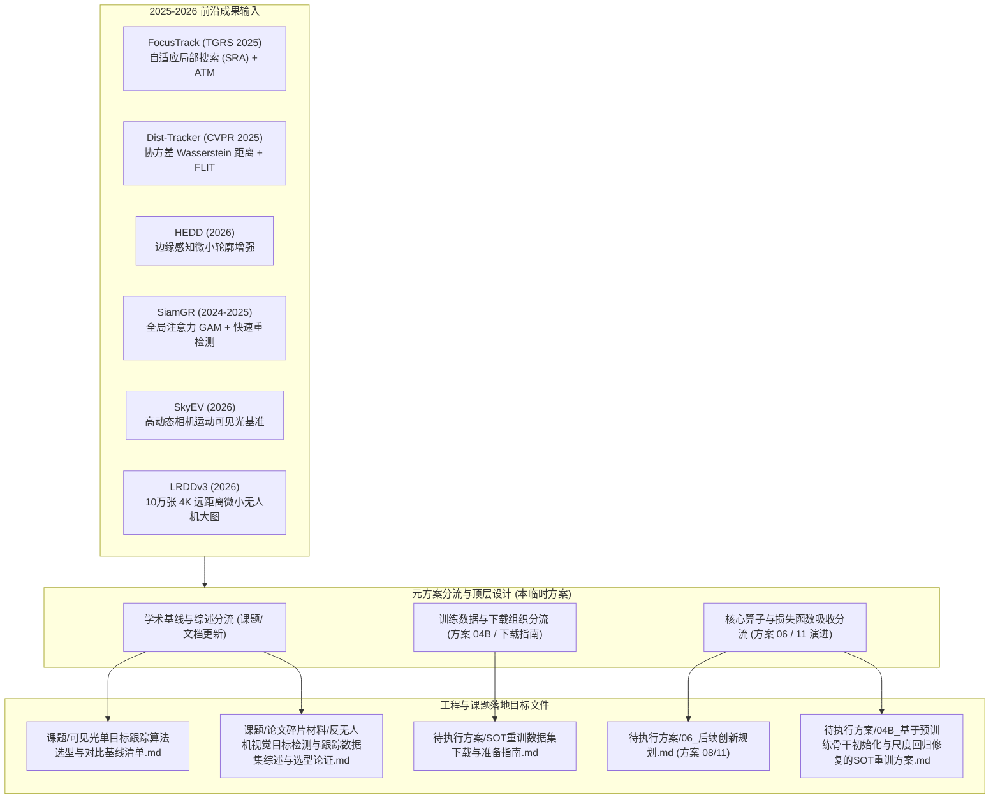

# 临时方案：前沿反无人机可见光轻量小模型与数据集纳入课题演进规划方案

> **方案性质**：元规划方案（方案的方案 / Meta-Planning Scheme）  
> **归属工程**：[RGB_PTZ_Integrated](file:///d:/PyProjects/RGB_PTZ_Integrated)  
> **归档位置**：[待执行方案/临时_前沿小模型与数据集纳入课题演进规划方案.md](file:///d:/PyProjects/RGB_PTZ_Integrated/待执行方案/临时_前沿小模型与数据集纳入课题演进规划方案.md)  
> **面向目标**：系统论证并规划如何将 2025–2026 年最新涌现的反无人机地对空可见光（RGB）**轻量小模型**与**前沿数据集**，有序收录、重组并映射至本课题的学术基线矩阵（`课题/`）与工程落地实操方案（`待执行方案/`）中。  
> **执行准则**：严格坚守长焦可见光（RGB）物理域；严守单输入静态 ONNX 与端侧 DirectML / RK3588 实时部署规范；不颠覆方案 04B 已确立的核心重训主干，采取“理论基准补强 + 核心算子吸收 + 渐进式消融扩展”的平滑演进路径。

---

## 一、 方案定位与元规划逻辑

本项目致力于构建面向低空防御与光电云台伺服闭环的轻量级反无人机视觉感知系统。随着计算机视觉顶会与期刊在 2025 至 2026 年针对“反无人机对空探测、微小弱目标连续跟踪、高动态视场机动”发布了新一代前沿成果，现有规划库需要进行针对性的前瞻扩充。

本临时方案作为**“方案的方案”**，不直接发起代码重构或破坏既有训练流水线，而是负责建立清晰的技术映射矩阵，明确将新模型算法机制与新数据集拆解到具体的课题文档与实施方案中：

---

## 二、 纳入对象的技术特征与工程吸收价值分析

### 2.1 轻量小模型技术矩阵

| 算法模型 | 年份/发表出处 | 核心架构与创新机制 | 对本工程/课题的吸收映射价值 |
| :--- | :--- | :--- | :--- |
| **FocusTrack** | IEEE TGRS 2025 (北理工团队) | 1. **SRA (自适应搜索区域调整)**：动态预测目标存在概率，自适应缩放与平移搜索视野； 2. **ATM (注意力掩码模块)**：恢复尺度变换造成的高频特征衰减； 3. **100+ FPS** 超高吞吐。 | **极高（运控协同）**：直接赋能光电长焦云台大角度旋转与加减速机动时的局部视场自适应，解决长焦视场下微小目标“瞬时脱靶”痛点，拟融入自研 SOT 跟踪外层搜索策略。 |
| **Dist-Tracker** | CVPR 2025 Anti-UAV Workshop | 1. **SSQ 检测器**：基于 YOLOv12 改进，融合带协方差对齐的尺度感知瓦瑟斯坦距离； 2. **FLIT 追踪器**：结合 L2 空间欧式距离与 IoU 混合度量，消除小目标几何畸变。 | **极高（损失与关联）**：与方案 11（弱小目标边界框损失选型）深度契合，为 NWD 损失引入高斯协方差对齐，进一步稳定反向传播梯度；FLIT 关联逻辑赋能 AMFT 检测匹配。 |
| **HEDD** | Taylor & Francis 2026 | 1. **Edge-Aware 模块**：单目可见光图像高频轮廓定向锐化； 2. **极轻卷积主干**：多尺度轻量金字塔，专门抑制远距离飞鸟/云层边缘引起的可见光虚警。 | **高（前处理/骨干）**：扩充检测基线横评库；边缘锐化算子可作为长焦图像预处理的低开销候选插件。 |
| **SiamGR / SiamGR-FR** | 2024–2025 工业/学术成果 | 1. **GAM 全局注意力**：抑制复杂低空地物与天空过渡区噪声； 2. **Alpha-Refine 细化**； 3. **FR 快速重检测分支**。 | **中高（学术对比）**：其“跟踪为主、检测兜底”的架构与本工程 AMFT 双模协同高度同构，是硕士论文第 4 章极具说服力的同行对比基线。 |

### 2.2 前沿可见光数据集技术矩阵

| 数据集名称 | 年份/来源 | 规模与数据模态 | 核心物理场景与纳入价值 |
| :--- | :--- | :--- | :--- |
| **SkyEV** | arXiv:2607.18747, 2026 | 4K 未压缩高动态可见光（RGB）+ 同步 Event 相机序列 | **高动态极限泛化基准**：专门采集剧烈相机自身运动（Camera Ego-motion）下的微小无人机连续视频，精准对标云台快速寻差与追随工况，作为算法高动态极限测试集。 |
| **LRDDv3** | IEEE ICRA / arXiv:2605.25942, 2026 | 102,532 张 4K 分辨率可见光静态大图，目标尺度普遍 $\le 50\text{ px}$，含精确测距标签 | **超远距离弱小目标扩展集**：补足当前 DUT Anti-UAV（10,000 张）在极端超视距小目标（$<16\times 16\text{ px}$）样本量上的不足，作为后续可选的扩展预训练与检测增量集。 |

---

## 三、 课题与方案文件体系的具体落地规划

为确保工程推进的有序性，按以下五个核心维度对既有规划文件实施更新与映射：

### 3.1 映射维度一：基线算法天梯榜扩充
* **目标文件**：[课题/可见光单目标跟踪算法选型与对比基线清单.md](file:///d:/PyProjects/RGB_PTZ_Integrated/课题/可见光单目标跟踪算法选型与对比基线清单.md)
* **具体规划动作**：
  1. 在**“第四梯队：反无人机（Anti-UAV）专属前沿轻量感知网络”**中：
     - 在原有的 `UAV-DETR` 基础上，正式增列 **`FocusTrack` (IEEE TGRS 2025)** 与 **`Dist-Tracker` (CVPR 2025)**；
     - 详细记录其参数量、FLOPs、FPS（FocusTrack 100+ FPS）及在公开基准上的 AUC 指标；
  2. 在**“第二梯队：顶会超轻量与移动端 SOT 核心基准”**中：
     - 增列 **`SiamGR`** 作为传统孪生网络加入全局注意力与细化头的经典对比项；
  3. 更新学术论证逻辑：论证自研轻量架构（RepVGG-A0 + MFFN + DAC-Head）在融合自适应搜索机制后，能够与 2025 年最新发表的 FocusTrack / Dist-Tracker 在极低算力区间展开正面性能竞争。

### 3.2 映射维度二：学位论文数据集综述与选型论证扩充
* **目标文件**：[课题/论文碎片材料/反无人机视觉目标检测与跟踪数据集综述与选型论证.md](file:///d:/PyProjects/RGB_PTZ_Integrated/课题/论文碎片材料/反无人机视觉目标检测与跟踪数据集综述与选型论证.md)
* **具体规划动作**：
  1. 在第 1.x.1 节“权威地对空反无人机基准数据集”中，新增两小节：
     - **LRDDv3 数据集（IEEE ICRA 2026）**：论证其 10 万张 4K 可见光对空大图在超远距离（极小弱目标）空间表征上的学术价值；
     - **SkyEV 数据集（2026）**：论证其在云台高动态转动、快速抖动与运动模糊工况下的鲁棒性评估价值；
  2. 巩固本文核心选型逻辑：维持 **DUT Anti-UAV** 与 **CASIA Anti-UAV300** 作为主实验主干训练与盲测闭环，将 LRDDv3 与 SkyEV 明确定义为“高动态与超远距离泛化鲁棒性消融扩展集”。

### 3.3 映射维度三：数据集准备与存储规范更新
* **目标文件**：[待执行方案/SOT重训数据集下载与准备指南.md](file:///d:/PyProjects/RGB_PTZ_Integrated/待执行方案/SOT重训数据集下载与准备指南.md)
* **具体规划动作**：
  1. 增设“第二部分：前沿可选扩展数据源（用于后期泛化验证与深化消融）”；
  2. 正式录入 **LRDDv3** 官方开源地址（`arXiv:2605.25942`）与 **SkyEV**（`arXiv:2607.18747`）仓库链接；
  3. 规范下载后的本地解压路径至 `D:\Datasets_SOT\LRDDv3` 与 `D:\Datasets_SOT\SkyEV`，与既有主干目录保持结构对称。

### 3.4 映射维度四：算法创新规划与损失函数演进升级
* **目标文件**：[待执行方案/06_后续创新规划.md](file:///d:/PyProjects/RGB_PTZ_Integrated/待执行方案/06_后续创新规划.md)
* **具体规划动作**：
  1. **升级方案 11（弱小目标边界框损失函数选型与消融探索方案）**：
     - 将原方案中的候选 3（标准 NWD）升级为**“结合协方差对齐的尺度感知瓦瑟斯坦损失（借鉴 Dist-Tracker CVPR 2025）”**；
     - 引入自适应高斯椭圆建模，使损失函数不仅惩罚中心点距离，而且对微小无人机飞行中的机身倾角进行动态几何约束；
  2. **升级方案 08（显式遮挡感知辅助头与时序轨迹外推网络）**：
     - 将原单一卡尔曼/GRU 轨迹外推，与 **FocusTrack 的 SRA 自适应局部采样机制**深度结合；
     - 设计长焦视场下的“搜索区域概率扩散自适应算法”：在云台高频转动时，依据预测方差自适应扩大搜索框窗口比例，目标重现后再自动收敛，彻底杜绝局部跟踪器容易出现的视场边缘跳脱问题。

### 3.5 映射维度五：重训方案 04B 的平滑兼容保证
* **目标文件**：[待执行方案/04B_基于预训练骨干初始化与尺度回归修复的SOT重训方案.md](file:///d:/PyProjects/RGB_PTZ_Integrated/待执行方案/04B_基于预训练骨干初始化与尺度回归修复的SOT重训方案.md)
* **具体规划动作**：
  1. 保持方案 04B 核心训练流水线（GOT-10k 50 轮预训练 + Anti-UAV300 30 轮微调）完全稳定不变；
  2. 在推理评测模块（`scripts/eval_sot.py`）预留搜索框缩放接口（`search_area_factor` 动态调节），为后续无缝挂载 FocusTrack SRA 机制打下底层代码扩展桩。

---

## 四、 阶段推进与执行依赖路线图

```mermaid
flowchart LR
    subgraph Step1 ["第一步: 理论基准与综述扩充 (即刻执行)"]
        A1["更新基线清单文档 (加入 FocusTrack/Dist-Tracker)"]
        A2["更新数据集选型论证 (加入 SkyEV/LRDDv3)"]
        A3["更新下载指南 (录入前沿扩展链接)"]
    end

    subgraph Step2 ["第二步: 核心重训基线交付 (方案 04B 主航道)"]
        B1["RTX 4080 Super 台式机数据下载与预处理"]
        B2["两阶段重训启动与收敛 (目标 AUC ≥ 58.0%)"]
        B3["DUT Anti-UAV 本地 20 组真机序列盲测达标"]
    end

    subgraph Step3 ["第三步: 前沿算法算子消融落地 (方案 06/08/11)"]
        C1["方案 11: 引入协方差 NWD 损失横向对拍"]
        C2["方案 08: 融入 FocusTrack SRA 动态搜索框外推"]
        C3["引入 SkyEV 高动态序列验证云台极限跟踪能力"]
    end

    Step1 --> Step2
    Step2 --> Step3
```

1. **第一阶段（文本与学术资产固化，零风险即刻推进）**：
   - 依据本规划方案，集中对 `课题/可见光单目标跟踪算法选型与对比基线清单.md`、`课题/论文碎片材料/反无人机视觉目标检测与跟踪数据集综述与选型论证.md` 及 `待执行方案/SOT重训数据集下载与准备指南.md` 执行规范化扩充；
2. **第二阶段（主干重训保底，保持战略聚焦）**：
   - 坚决保障方案 04B 在台式机上的三阶段重训与 DUT Anti-UAV 盲测闭环，优先攻克尺度回归发散与 AUC 瓶颈，产出高可信度的第一版 LightUAV-SOT 交付权重；
3. **第三阶段（前沿算子二次增益消融）**：
   - 在基线模型就绪后，激活升级后的方案 11 与方案 08，利用协方差 NWD 损失与 FocusTrack SRA 动态视场机制产出硕士论文所需的高阶消融图表与极值指标。
