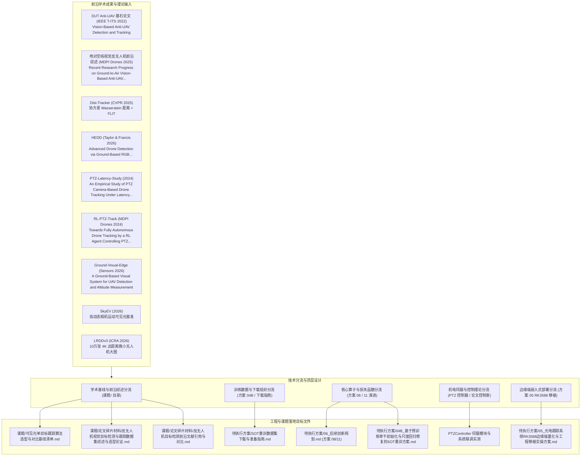

# 临时方案：前沿反无人机可见光轻量小模型与数据集纳入课题演进规划方案

> **方案性质**：元规划方案（方案的方案 / Meta-Planning Scheme）  
> **归属工程**：[RGB_PTZ_Integrated](file:///d:/PyProjects/RGB_PTZ_Integrated)  
> **归档位置**：[待执行方案/临时_前沿小模型与数据集纳入课题演进规划方案.md](file:///d:/PyProjects/RGB_PTZ_Integrated/待执行方案/临时_前沿小模型与数据集纳入课题演进规划方案.md)  
> **面向目标**：系统论证并规划如何将 2022–2026 年最新涌现的反无人机地对空纯可见光（RGB）**轻量小模型**、**权威基准文献**、**机电延迟伺服控制实证**与**前沿数据集**，有序收录、重组并映射至本课题的学术基线矩阵（`课题/`）与工程落地实操方案（`待执行方案/`）中。  
> **执行准则**：严格坚守长焦纯可见光（RGB）物理域；严守单输入静态 ONNX 与端侧 DirectML / RK3588 实时部署规范；不颠覆方案 04B 已确立的核心重训主干，采取“理论基准补强 + 核心算子吸收 + 渐进式消融扩展 + 控制闭环实证”的演进路径。

---

## 一、 方案定位与元规划逻辑

本项目致力于构建面向低空防御与光电云台伺服闭环的轻量级反无人机纯视觉感知系统。随着计算机视觉与智能运控领域在反无人机“地对空探测、微小弱目标连续跟踪、长焦视场机电延迟补偿”等方向的演进，现有规划库需要系统性融入最新的前沿文献与模型机制。

### 1.1 多分支探索与单主线收敛原则
本方案规划的改进方向属于**候选实验探索分支（Candidate Exploration Branches）**。在前期研发阶段建立多分支横向对比，以充分验证算法在空域弱小目标上的性能边界；**最终写入硕士学位论文核心章节的，必须且仅能是在实测对拍中表现最优的单条主线（The Single Optimal Path）**。其余候选设计统一沉淀为对比与消融实验支撑，杜绝无节制拼凑复杂模块，确保论文主干架构自洽、重点聚焦、论证严谨。

### 1.2 技术映射与顶层设计
本临时方案作为**“方案的方案”**，不直接发起代码重构或破坏既有训练流水线，而是负责建立清晰的技术映射矩阵，明确将新模型算法机制、实证研究与数据集拆解到具体的课题文档与实施方案中：

---

## 二、 纳入对象的技术特征与工程吸收价值分析

### 2.1 轻量小模型与云台机电控制技术矩阵

| 算法模型 / 研究出处 | 完整论文题目与收录刊物 | 核心架构与创新机制 | 对本工程/课题的吸收映射价值 |
| :--- | :--- | :--- | :--- |
| **DUT-AntiUAV-Base** | 《Vision-Based Anti-UAV Detection and Tracking》 (IEEE T-ITS 2022, 大连理工大学) | 1. **全场景基准构建**：纯可见光地对空 10,000 张静态大图 + 20 段长焦跟踪连续序列 (24,784 帧)； 2. **跨视场协同**：大视场粗定位与长焦窄视场精跟踪机制。 | **基石数据集与学术根基**：本工程本地已就绪数据集（`datasets/Anti-UAV/`）的原生理论依据，作为方案 03 检测微调与方案 04 跟踪盲测的基准数据源。 |
| **Ground-to-Air Review** | 《Recent Research Progress on Ground-to-Air Vision-Based Anti-UAV Detection and Tracking Methodologies: A Review》 (MDPI Drones 2025) | 1. **体系化归纳**：全面梳理地对空纯视觉反无人机技术演进全景； 2. **机理分析**：深入剖析遮挡诱发的目标“信息真空区（Information Void）”。 | **理论引证基石**：为学位论文第 1 章（低空安防态势与地对空视觉感知现状）提供系统的顶层综述与权威文献支撑。 |
| **Dist-Tracker** | 《Dist-Tracker: Scale-Aware Distance Matching for Anti-UAV Tracking》 (CVPR 2025 Anti-UAV Workshop) | 1. **SSQ 检测器**：基于 YOLOv12 改进，融合带协方差对齐的尺度感知 Wasserstein 距离； 2. **FLIT 追踪器**：结合 L2 空间欧氏距离与 IoU 混合度量，消除小目标几何畸变。 | **边界框损失与关联匹配**：与方案 11（弱小目标边界框损失选型）深度契合，为 NWD 损失引入高斯协方差对齐；FLIT 关联逻辑赋能 AMFT 检测特征匹配。 |
| **HEDD** | 《Advanced Drone Detection via Ground-Based RGB Surveillance Using Efficient Deep Learning Architectures》 (Taylor & Francis 2026) | 1. **Edge-Aware 模块**：单目可见光图像高频轮廓定向锐化； 2. **极轻卷积主干**：多尺度轻量金字塔，专门抑制远距离飞鸟/云层边缘引起的可见光假阳性虚警。 | **特征增强与抗虚警**：扩充检测基线横评库；边缘锐化算子为长焦弱小目标图像预处理提供低开销候选机制。 |
| **SiamGR / SiamGR-FR** | 《SiamGR: Siamese Network with Global Attention and Refinement for UAV Tracking》 (2024–2025 成果) | 1. **GAM 全局注意力**：抑制复杂低空地物与天空过渡区噪声； 2. **Alpha-Refine 细化分支**； 3. **FR 快速重检测分支**。 | **学术对比基线**：其“跟踪为主、检测兜底”的双模架构与本工程 AMFT 协同高度同构，作为硕士论文第 4 章学术基准对比项。 |
| **PTZ-Latency-Study** | 《An Empirical Study of PTZ Camera-Based Drone Tracking Under Latency and Detector Challenges》 (2024 实证研究) | 1. **长焦云台延迟建模**：系统量化视频传输延迟、检测抖动与机电 PID 伺服滞后的相互耦合； 2. **时延补偿自适应控制**：前馈速度预测与自适应滤波。 | **控制闭环理论支撑**：直接支撑工程现有 `PTZController`、Pelco-D 串口伺服、KF 速度前馈与脱靶量自适应平滑机制，为论文第 5 章提供坚实控制实验依据。 |
| **RL-PTZ-Track** | 《Towards Fully Autonomous Drone Tracking by a Reinforcement Learning Agent Controlling a Pan–Tilt–Zoom Camera》 (MDPI Drones 2024) | 1. **强化学习控制 PTZ**：由强化学习代理直接根据可见光目标图像偏差回归云台水平/俯仰转速； 2. **狭窄视场出画抑制**：针对长焦视场（Narrow FOV）目标高动态机动防丢优化。 | **智能伺服参考**：为光电云台在大倍率长焦下跟踪高机动微小目标时的超调防丢与增益自适应调节提供算法设计参考。 |
| **Ground-Visual-Edge** | 《A Ground-Based Visual System for UAV Detection and Altitude Measurement: Deployment and Evaluation on Edge Devices》 (MDPI Sensors 2026) | 1. **Ghost-YOLOv11n 轻量检测**：针对地对空微小无人机航迹提取与状态平滑； 2. **边缘部署与高度估算**：端侧低功耗设备上的连续位姿推断与实时运行。 | **边缘端落地参考**：为方案 05（RK3588 边缘端量化与工程移植）提供算法量化、端侧低功耗实时运行及高度测量对照参考。 |

### 2.2 前沿可见光数据集技术矩阵

| 数据集名称 | 年份/发表出处 | 规模与数据模态 | 核心物理场景与纳入价值 |
| :--- | :--- | :--- | :--- |
| **DUT Anti-UAV** | IEEE T-ITS 2022 (大连理工大学) | 10,000 张静态检测集（覆盖晴天、阴天、逆光、夜间）+ 20 段长焦连续跟踪视频序列（24,784 帧） | **原生基石基准**：本工程本地已就绪核心数据资产，支撑方案 03 的 YOLO 领域微调与方案 04 的自研 SOT 盲测闭环。 |
| **CASIA Anti-UAV300** | IEEE CVPR 2020 / TPAMI 2021 (中科院自动化所/清华大学) | 300 段全模态序列，抽取 100 段全量地对空可见光真彩连续航迹 | **核心领域重训集**：方案 04B 第三阶段地对空领域微调的主干数据源，构建连续长时航迹表征能力。 |
| **SkyEV** | arXiv:2607.18747, 2026 | 4K 未压缩高动态可见光（RGB）+ 同步 Event 相机序列 | **高动态极限泛化基准**：专门采集剧烈相机自身运动（Camera Ego-motion）下的微小无人机连续视频，精准对标云台快速寻差与追随工况，作为算法高动态极限测试集。 |
| **LRDDv3** | IEEE ICRA / arXiv:2605.25942, 2026 | 102,532 张 4K 分辨率可见光静态大图，目标尺度普遍 $\le 50\text{ px}$，含精确测距标签 | **超远距离弱小目标扩展集**：补足极远距离超微小目标（$<16\times 16\text{ px}$）样本量，作为后续可选的扩展预训练与增量消融集。 |

---

## 三、 课题与方案文件体系的具体落地规划

为确保工程推进的有序性，按以下八个核心维度对既有规划文件实施更新与映射：

### 3.1 映射维度一：基线算法天梯榜扩充
* **目标文件**：[课题/可见光单目标跟踪算法选型与对比基线清单.md](file:///d:/PyProjects/RGB_PTZ_Integrated/课题/可见光单目标跟踪算法选型与对比基线清单.md)
* **具体规划动作**：
  1. 在**“第四梯队：反无人机（Anti-UAV）专属前沿轻量感知网络”**中：
     - 在原有的 `UAV-DETR` 基础上，正式增列 **`Dist-Tracker` (CVPR 2025)**；
     - 详细记录其参数量、FLOPs、几何关联机制及公开基准指标；
  2. 在**“第二梯队：顶会超轻量与移动端 SOT 核心基准”**中：
     - 增列 **`SiamGR`** 作为孪生网络加入全局注意力与细化分支的对比项；
  3. 更新学术论证逻辑：论证自研轻量架构（RepVGG-A0 + MFFN + DAC-Head）在引入协方差几何损失后，能够与 2025 年最新发表的轻量网络在极低算力区间展开正面性能竞争。

### 3.2 映射维度二：学位论文数据集综述与选型论证扩充
* **目标文件**：[课题/论文碎片材料/反无人机视觉目标检测与跟踪数据集综述与选型论证.md](file:///d:/PyProjects/RGB_PTZ_Integrated/课题/论文碎片材料/反无人机视觉目标检测与跟踪数据集综述与选型论证.md)
* **具体规划动作**：
  1. 在第 1.x.1 节“权威地对空反无人机基准数据集”中：
     - 系统引用 《Vision-Based Anti-UAV Detection and Tracking》（IEEE T-ITS 2022），确立 DUT Anti-UAV 在可见光地空检测与跟踪维度的基石地位；
     - 引入 2025 年最新专题综述《Recent Research Progress on Ground-to-Air Vision-Based Anti-UAV Detection and Tracking Methodologies: A Review》，补强地对空纯视觉反无人机技术演进全景引证；
     - 新增 **LRDDv3 数据集（IEEE ICRA 2026）** 与 **SkyEV 数据集（2026）** 分析小节，论证其在超远距离小目标与云台高动态相机运动（Camera Ego-motion）下的鲁棒性评估价值；
  2. 巩固核心选型逻辑：维持 **DUT Anti-UAV** 与 **CASIA Anti-UAV300** 作为主实验主干训练与盲测闭环，将 LRDDv3 与 SkyEV 明确定义为高动态与超远距离泛化消融扩展集。

### 3.3 映射维度三：反无人机前沿目标检测与边缘部署基线扩充
* **目标文件**：[课题/论文碎片材料/反无人机目标检测前沿文献引用与对比.md](file:///d:/PyProjects/RGB_PTZ_Integrated/课题/论文碎片材料/反无人机目标检测前沿文献引用与对比.md)
* **具体规划动作**：
  1. 增设 **HEDD (Taylor & Francis 2026)** 小节，解析其 Edge-Aware 模块与极轻卷积主干，对比其与现有 YOLOv8/11 在远距离小目标高频特征保留上的机制差异；
  2. 增设 **Ground-Visual-Edge (Sensors 2026)** 小节，解析 Ghost-YOLOv11n 在端侧低功耗硬件上的部署表现，补充地对空连续高度估算模型；
  3. 扩充学术对比大表，将 HEDD 与 Ghost-YOLOv11n 纳入推理时延与 mAP 指标横向对比。

### 3.4 映射维度四：数据集准备与存储规范更新
* **目标文件**：[待执行方案/SOT重训数据集下载与准备指南.md](file:///d:/PyProjects/RGB_PTZ_Integrated/待执行方案/SOT重训数据集下载与准备指南.md)
* **具体规划动作**：
  1. 增设“第二部分：前沿可选扩展数据源（用于后期泛化验证与深化消融）”；
  2. 正式录入 **LRDDv3** 官方开源地址（`arXiv:2605.25942`）与 **SkyEV**（`arXiv:2607.18747`）仓库链接；
  3. 规范下载后的本地解压路径至 `D:\Datasets_SOT\LRDDv3` 与 `D:\Datasets_SOT\SkyEV`，与既有主干目录保持结构对称。

### 3.5 映射维度五：算法创新规划与损失函数演进升级
* **目标文件**：[待执行方案/06_后续创新规划.md](file:///d:/PyProjects/RGB_PTZ_Integrated/待执行方案/06_后续创新规划.md)
* **具体规划动作**：
  1. **升级方案 11（弱小目标边界框损失函数选型与消融探索方案）**：
     - 将原方案中的候选 3（标准 NWD）升级为**“结合协方差对齐的尺度感知 Wasserstein 损失（借鉴 Dist-Tracker CVPR 2025）”**；
     - 引入自适应高斯椭圆建模，使损失函数不仅惩罚中心点距离，而且对微小无人机飞行中的机身倾角进行动态几何约束；
  2. **升级方案 08（显式遮挡感知辅助头与时序轨迹外推网络）**：
     - 构建长焦视场下的局部时序外推网络，联动卡尔曼观测器进行盲区航迹推演，在云台运动与目标短暂遮挡期间保持跟踪平滑与视轴稳定。

### 3.6 映射维度六：重训方案 04B 的平滑兼容保证
* **目标文件**：[待执行方案/04B_基于预训练骨干初始化与尺度回归修复的SOT重训方案.md](file:///d:/PyProjects/RGB_PTZ_Integrated/待执行方案/04B_基于预训练骨干初始化与尺度回归修复的SOT重训方案.md)
* **具体规划动作**：
  1. 保持方案 04B 核心训练流水线（GOT-10k 50 轮预训练 + Anti-UAV300 30 轮微调）完全稳定不变；
  2. 在推理评测模块（`scripts/eval_sot.py`）完善尺度评估指标，打通 DUT Anti-UAV 盲测闭环。

### 3.7 映射维度七：云台闭环控制与时延补偿机制支撑
* **目标文件**：`PTZController` 与学位论文控制章节
* **具体规划动作**：
  1. 借鉴《An Empirical Study of PTZ Camera-Based Drone Tracking Under Latency and Detector Challenges》（2024）关于长焦跟踪下控制延迟、检测置信度抖动与 PID 超调的建模方法，为本工程 KF 速度前馈与速度随角度平滑回传（C1 项）提供实证控制论证；
  2. 借鉴《Towards Fully Autonomous Drone Tracking by a Reinforcement Learning Agent Controlling a Pan–Tilt–Zoom Camera》（MDPI Drones 2024）的窄视场抗出画策略，完善长焦机电跟踪保护。

### 3.8 映射维度八：嵌入式边缘轻量化部署与工程移植实操方案
* **目标文件**：[待执行方案/05_光电跟踪系统RK3588边缘端量化与工程移植实操方案.md](file:///d:/PyProjects/RGB_PTZ_Integrated/待执行方案/05_光电跟踪系统RK3588边缘端量化与工程移植实操方案.md)
* **具体规划动作**：
  1. 参考《A Ground-Based Visual System for UAV Detection and Altitude Measurement》（MDPI Sensors 2026）的端侧低功耗检测与连续航迹拟合，为方案 05 的 NPU 多核调度亲和性与端到端实时性提供评测对照。

---

## 四、 阶段推进与执行依赖路线图

```mermaid
flowchart LR
    subgraph Step1 ["第一步: 理论基准与综述扩充 (即刻执行)"]
        A1["更新基线清单文档 (加入 Dist-Tracker)"]
        A2["更新数据集选型论证 (加入 SkyEV/LRDDv3/DUT 基石论文)"]
        A3["更新检测前沿对比 (加入 HEDD/Ground-Visual-Edge)"]
        A4["更新下载指南 (录入前沿扩展链接)"]
    end

    subgraph Step2 ["第二步: 核心重训基线交付 (方案 04B 主航道)"]
        B1["RTX 4080 Super 台式机数据下载与预处理"]
        B2["两阶段重训启动与收敛 (目标 AUC ≥ 58.0%)"]
        B3["DUT Anti-UAV 本地 20 组真机序列盲测达标"]
    end

    subgraph Step3 ["第三步: 前沿算法算子消融落地 (方案 06/08/11)"]
        C1["方案 11: 引入协方差 NWD 损失横向对拍"]
        C2["方案 08: 遮挡感知时序外推消融验证"]
        C3["引入 SkyEV 高动态序列验证云台极限跟踪能力"]
    end

    Step1 --> Step2
    Step2 --> Step3
```

1. **第一阶段（文本与学术资产固化，即刻推进）**：
   - 依据本规划方案，集中对 `课题/可见光单目标跟踪算法选型与对比基线清单.md`、`课题/论文碎片材料/反无人机视觉目标检测与跟踪数据集综述与选型论证.md`、`课题/论文碎片材料/反无人机目标检测前沿文献引用与对比.md` 及 `待执行方案/SOT重训数据集下载与准备指南.md` 执行规范化扩充；
2. **第二阶段（主干重训保底，保持战略聚焦）**：
   - 坚决保障方案 04B 在台式机上的三阶段重训与 DUT Anti-UAV 盲测闭环，优先攻克尺度回归发散与 AUC 瓶颈，产出高可信度的第一版 LightUAV-SOT 交付权重；
3. **第三阶段（前沿算子二次增益消融）**：
   - 在基线模型就绪后，激活升级后的方案 11 与方案 08，利用协方差 NWD 损失产出硕士论文所需的高阶消融图表与极值指标。
